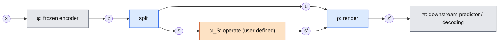
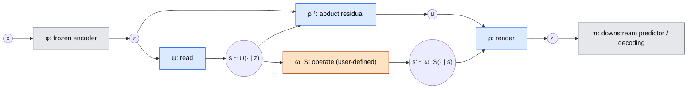
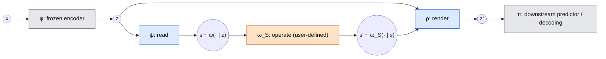

# Contribution and positioning

Literature overview: [background.md](background.md). Architectures:
[architecture/latent_intervention.md](architecture/latent_intervention.md).

**Notation (provisional, this doc only).** Greek letters for functions, Latin letters for
variables. The other docs still use the old names (right column).

| here | meaning | elsewhere |
|---|---|---|
| $x, z, \mathbf s, u$ | text, latent, structured state, residual (what $z$ carries beyond $\mathbf s$) | same |
| $\mathbf s', z'$ | target state, edited latent | same |
| $\varphi$ | frozen text encoder | $f$ |
| $\psi(\mathbf s\mid z)$ | reader (semantic decoder) | $g$ |
| $\omega_S(\mathbf s'\mid\mathbf s)$ | user-defined operator on states | $h_S$ |
| $\rho$, $\rho^{-1}$ | renderer, and abduction of the residual | $F_\theta$, $F_\theta^{-1}$ (F1); $z+\Delta_\phi$ (C) |
| $\omega_Z(z'\mid z)$ | resulting operator on latents | $h_Z$ |
| $\pi$ | downstream predictor or decoder | $p$ |
| $\Gamma$ | $\psi$'s confusion on real latents | — |

## Contribution statement

> We control the representation of a frozen text encoder through a **symbolic operator that the
> user defines**. A reader $\psi$ infers a structured state from the latent, the operator
> $\omega_S$ transforms the state, and a renderer $\rho$ writes the target state back into the
> latent while keeping everything the state does not describe. $\psi$ and $\rho$ are learned
> once, from factual (latent, state) pairs only. No training step sees $\omega_S$, an
> intervention, or counterfactual data, so the operator can be exchanged at inference without
> retraining. SCM counterfactuals for counterfactual fairness are the running instance.

Colours in the charts: grey = frozen, blue = learned once from factual data, orange =
user-defined and exchangeable.

### Conceptual signal–residual split

Conceptually, $z$ splits into a state $\mathbf s$ and a residual $u$; only the state is operated
on. In practice the split is not observed: $\mathbf s$ is inferred with uncertainty, and $u$ is
either abducted explicitly (implementation 1) or left implicit in $z$ (implementation 2).

### Implementation 1: read–abduct–render (state-conditioned flow, F1)

$\psi$ and $\rho$ (with its abduction) are learned once from factual $(z,\mathbf s)$; $\omega_S$
is the only part that changes between uses.

Given the states, abduction $u=\rho^{-1}(z;\mathbf s)$ and rendering $z'=\rho(u;\mathbf s')$ are
deterministic; all spread in $z'$ comes from $\mathbf s\sim\psi$ and $\mathbf s'\sim\omega_S$.
The residual is preserved by construction ($\mathbf s'=\mathbf s \Rightarrow z'=z$ exactly).

### Implementation 2: state realiser (C-sym, planned)

There is no explicit residual: $z$ itself is the context, $z' = z + \Delta_\theta(z,\mathbf s')$.
Preservation therefore holds only through a proximity penalty, not by construction, and the
realiser is trained so that $\psi$ reads $\mathbf s'$ (see the constraints below).

## Formulation

$$\omega_Z(\cdot\mid z;\,\omega_S) \;=\; \sum_{\mathbf s} \psi(\mathbf s\mid z) \sum_{\mathbf s'} \omega_S(\mathbf s'\mid \mathbf s)\;
\rho\big(\cdot \mid u(z,\mathbf s),\,\mathbf s'\big)$$

* **Read.** $\psi(\mathbf s\mid z)$ is a distribution: the state is inferred, not observed, and
  some variables (talent $\texttt T$) are never stated in the text.
* **Operate.** $\omega_S: \mathcal S\to\Delta(\mathcal S)$ is any kernel on states: an SCM
  counterfactual, a path-specific counterfactual, an erasure, a deterministic rule. Dependencies
  between variables (mediators under $do(\cdot)$) are handled here, symbolically, so the latent
  side never has to learn causal propagation.
* **Render.** $\rho$ puts a state into the latent and keeps the residual $u$. Instances:
  * state-conditioned flow (F1, implemented): $u = F_\theta^{-1}(z;\mathbf s)$,
    $z' = F_\theta(u;\mathbf s')$, fitted by conditional likelihood $p_\theta(z\mid\mathbf s)$;
  * state realiser (C-sym, planned): $z' = z + \Delta_\theta(z,\mathbf s')$ with weights from
    $\omega_S\circ\psi$.

### Requirements on the renderer

These replace the earlier commuting-square constraint $\psi\circ\omega_Z = \omega_S\circ\psi$.

* **R1 Fidelity.** A rendered latent for state $\mathbf s'$ looks like a real latent with state
  $\mathbf s'$: $\rho(\cdot\mid u,\mathbf s')$ with $u$ from the base law matches
  $p(z\mid\mathbf s')$. Consequence:
  $$\psi\circ\omega_Z \;=\; \Gamma\,(\omega_S\circ\psi),\qquad
  \Gamma(\tilde{\mathbf s}\mid\mathbf s') = \mathbb E_{z\sim p(z\mid\mathbf s')}\big[\psi(\tilde{\mathbf s}\mid z)\big],$$
  where $\Gamma$ is $\psi$'s confusion on *real* latents. The edited latent is read exactly as
  well as a real one, no better. The strict square ($\Gamma = I$) is unattainable for hidden
  variables and, if forced, rewards off-manifold (adversarial) edits.
* **R2 Preservation.** Everything outside $\mathbf s$ is kept: $\mathbf s' = \mathbf s \Rightarrow
  z' = z$, and the residual $u$ is shared across states. Shared $u$ is not identified by factual
  data (Nasr-Esfahany et al. 2023); it is an assumption, tested on paired counterfactual latents.
* **R3 Operator-agnostic training.** $\psi$ and $\rho$ see only factual $(z,\mathbf s)$. The
  renderer must cover every target state an operator can produce; that state support, not a set
  of trained interventions, defines which $\omega_S$ are usable.

### Evaluation

* **Fidelity:** $\psi\circ\omega_Z$ against $\Gamma\,(\omega_S\circ\psi)$, with $\Gamma$
  estimated on *factual* latents of each state (R1), not against $\omega_S\circ\psi$ alone. This
  needs no counterfactual text. The reader used here is independent of the one in the
  pipeline. Support distance to real latents of state $\mathbf s'$.
* **Preservation and recovery:** identity at $\mathbf s'=\mathbf s$; energy score and distance to
  paired $\varphi(x')$.
* **Operator exchange:** several $\omega_S$ with one trained $\rho$ (below).
* **Use:** downstream predictor $\pi(Z)$ vs. $\pi(\omega_Z(Z))$ vs. $\pi(Z')$ (downstream
  benchmark).

## What this changes relative to the earlier statement

| Earlier | Now |
|---|---|
| Learn $h_Z$ such that $g\circ h_Z = h_S\circ g$ | Read → operate → render; consistency holds up to $\psi$'s own confusion (R1) |
| $h_Z$ internalises the SCM; source-free and amortised in the intervention | $\omega_S$ is the control input at inference; amortising one fixed $\omega_S$ (F2) is optional |
| $h_Z$ must inject mediator effects | Mediators are propagated symbolically by $\omega_S$; $\rho$ renders joint states |
| Lift selection: which $z'\in g^{-1}(\mathbf s')$? | Rendering identifiability: is shared $u$ the right alignment across states? |
| SCM counterfactuals now, general operators later | General operators now; SCM counterfactual is the running instance |

Unchanged: paired counterfactual texts are used for evaluation only.

## Evidence needed

One trained $\psi$ and $\rho$, several operators:

1. **SCM total effect**, $do(\texttt X = x)$ (current experiment; paired texts exist).
2. **Path-specific counterfactual**: $\texttt X$ changed, $\texttt D, \texttt U$ held at factual
   values (direct effect). Paired texts can be simulated with the same SCM.
3. **Erasure**: $\texttt X$ replaced by a draw from its marginal; compare with LEACE.
4. **Deterministic rule**, e.g. an ordinal increment of $\texttt U$, with no causal reading.

The kernel is pluggable via `objects.symbolic_kernel`. Instances 3 and 4 have no paired ground
truth, so they rely on fidelity (R1) and preservation (R2) diagnostics.

## Neighbouring work

Per-paper details and relevance ranking: [background.md](background.md).

| Line of work | Same | Different |
|---|---|---|
| Causal abstraction, IIT (Geiger et al. 2021, 2022) | aligning a symbolic model with a neural representation | symbolic model is the network's own computation; downstream layers propagate edits. Ours is an external operator |
| DAS / Boundless DAS (Geiger et al. 2023; Wu et al. 2023) | learned alignment of subspaces with symbolic variables | needs a **source input** at intervention time; point-wise |
| ReFT / LoReFT (Wu et al. 2024) | learned edit of a frozen representation | one edit per task, trained on labels; ours learns one renderer and takes the edit from $\omega_S$ |
| Activation steering, RepE (Rimsky et al. 2024; Zou et al. 2023) | control of a frozen representation | specified by examples (contrast pairs), additive, one concept at a time |
| Concept erasure (Ravfogel et al. 2020; Belrose et al. 2023) | provable representation control | one fixed operator (erasure), linear; for us erasure is one $\omega_S$ |
| Deep SCM (Pawlowski et al. 2020), VACA | abduction and rendering with a conditional generative model | parents are observed labels; one fixed SCM. Ours: state inferred by $\psi$, operator exchangeable |
| StyleFlow (Abdal et al. 2021) | conditional flow over a frozen latent space; invert, then regenerate | attributes edited independently by hand; no operator on states |
| Concept bottleneck models (Koh et al. 2020) | editable symbolic state between input and output | trained end-to-end; edits on the state, not on the representation |
| MDP homomorphisms (van der Pol et al. 2020), neural algorithmic reasoning | abstract operator executed in latent space | encoder trained jointly with the operator |
| Equivariant representations (Higgins et al. 2018) | latent operator mirroring a symbolic one | invertible group actions; $do(\cdot)$ and erasure are not invertible |
| RAVEL (Huang et al. 2024), CEBaB, LIBERTy | evaluating targeted edits / counterfactual text | benchmarks, not methods; adopt Cause/Isolate scores |

Shared differentiator: **post hoc** on a frozen encoder, **operator-agnostic training**, a
**symbolic control interface**, and an **inferred** state.

## Constraints that follow

- **Reading is uncertain.** $\psi$ is a probe: it can read information the model does not use,
  and it is imperfect on hidden variables. Its uncertainty must reach $\omega_S$ (sample
  $\mathbf s\sim\psi(\cdot\mid z)$, not argmax; open for F1).
- **Render by likelihood, not against $\psi$.** A renderer trained so that $\psi$ reads
  $\mathbf s'$ (C's realiser) is pushed towards $\Gamma = I$, i.e. off-manifold edits; with a
  free nonlinear map this is trivially satisfiable (non-linear representation dilemma, Sutter et
  al. 2025) and prone to interpretability illusions (Makelov et al. 2023). F1 avoids this by
  never using $\psi$ in training.
- **State support bounds the operators.** $\rho$ is reliable only for states seen in training.
- **Baselines:** a constant direction $z' = z + v$ per operator (steering-style); DAS-style swap
  with a source latent (upper bound, needs paired data); oracle regression on paired $Z'$
  (reference); LEACE for the erasure instance.
