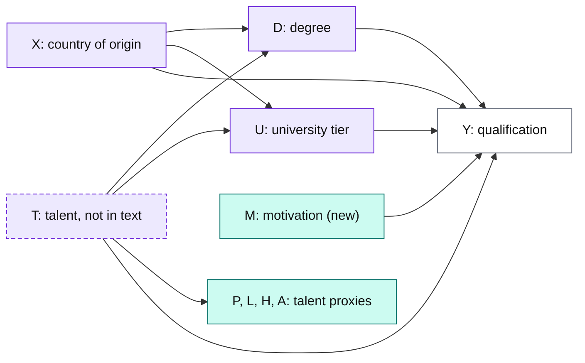
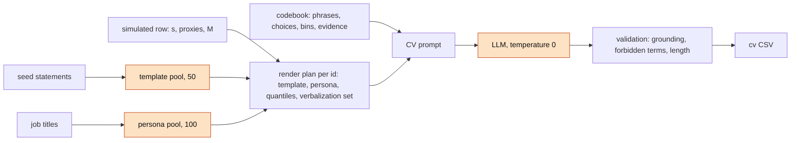
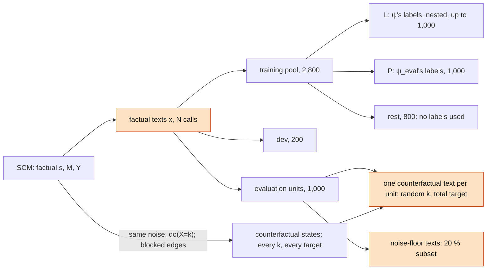

# Data simulation: DAG, counterfactuals and texts

Status: the base talent SFM is implemented in
[exp/sim_talent/talent_sfm.py](../../exp/sim_talent/talent_sfm.py) and
[exp/sim_talent/config.yaml](../../exp/sim_talent/config.yaml). The $\texttt M$ extension is implemented as
the sibling experiment [exp/sim_talent_motivation/talent_motivation.py](../../exp/sim_talent_motivation/talent_motivation.py) with
[config.yaml](../../exp/sim_talent_motivation/config.yaml). Per-unit
interventions, path-specific targets, partitions, noise-floor texts and verbalization sets are
still design ([Required changes](#required-changes)). This doc is the data reference for the
[wrong-symbolic-model experiment](wrong_symbolic_model.md) and its
[reader](reader_benchmark.md), [operator](operator_benchmark.md) and
[renderer](renderer_benchmark.md) benchmarks. Notation as in
[contribution.md](../contribution.md); $\texttt{typewriter}$ for SCM variables.

## DAG

The standard fairness model (SFM) of Plečko & Bareinboim, instantiated for CV screening:
$\texttt X$ is the protected attribute, $\texttt T$ the SFM's confounder slot (renamed so it
does not clash with the latent $z$), $\texttt D$ and $\texttt U$ the mediators, and
$\texttt Y$ the outcome. The talent proxies are a measurement model for the hidden
$\texttt T$. The extension adds **$\texttt M$ (motivation)**.

Purple = in the full state $\mathbf s = (\texttt X, \texttt T, \texttt D, \texttt U)$ (dashed:
not in the text, read only through the proxies), teal = verbalized, not in the full state
($\texttt M$ joins the state only in condition S6/O5), white = outcome, neither in the state nor
in the text.

Structural properties the experiments rely on:

- **Every parent of $\texttt D$ and $\texttt U$ is in $\mathbf s$**, so the closed-form kernel
  over $\mathbf s$ is exact without the proxies.
- **$\texttt T$ and $\texttt M$ are non-descendants of $\texttt X$**, so $do(\texttt X)$ leaves
  them, and the proxies, unchanged.
- **$\texttt X$ is a root, independent of $\texttt T$.** There is no spurious path (the SFM's
  $\texttt X$–$\texttt Z$ confounding). This favours transport-based methods; see "Where the
  simulation is kinder than reality" in the experiment doc, and the confounded world below.
- **$\texttt D$ and $\texttt U$ are near-symmetric** (coefficients below). This is why the
  "$\texttt U$ omitted" condition was dropped; the asymmetric world below revisits it.

**Why $\texttt M$.** Without it, the only non-state content of $z$ is persona and style, which
carries nothing about $\texttt Y$. $\texttt M$ puts $\texttt Y$-relevant information into the
residual $u$. A renderer that keeps $u$ (R2) keeps $\texttt M$; one that overwrites the latent
loses it.

**Why motivation.** It is plausibly independent of origin, degree and talent and has a direct
effect on performance. In the text it must stay separable from talent: "sustained effort,
follows through, takes on additional responsibility" vs. the proxy evidence for
$\texttt P$/$\texttt L$/$\texttt H$/$\texttt A$, in particular "sought out for advice"
($\texttt A$) and "completed projects" ($\texttt P$). Check on the generated texts: the
evaluation reader reads $\texttt M$ above chance, and its $\texttt M$ predictions do not
correlate with $\texttt T$ ($\texttt M\perp\texttt T$ in the simulation).

## Structural equations

Every non-root node is a rounded and clipped linear mechanism without intercept:

$$\texttt V = \operatorname{clip}_{[0,\,k_V-1]}\Big(\operatorname{round}\Big(\textstyle\sum_{j} \beta_{Vj}\,\mathrm{pa}_j + \varepsilon_V\Big)\Big),\qquad \varepsilon_V\sim\mathcal N(\mu_V,\sigma_V^2),$$

with round half-to-even (`clip_round` in [exp/sim/scm.py](../../exp/sim/scm.py), matching R's
`round()`).

| Node | Levels | Parents and coefficients | Noise $(\mu,\sigma)$ | In state | In text |
|---|---|---|---|---|---|
| $\texttt X$ | 4 regions | root, uniform | – | yes | yes (country) |
| $\texttt T$ | 3 | root, $P = (0.25, 0.50, 0.25)$ | – | yes | no |
| $\texttt M$ (new) | 3 | root, $P = (0.25, 0.50, 0.25)$ (as $\texttt T$) | – | S6/O5 only | yes (evidence) |
| $\texttt D$ | 3 | $0.30\,\texttt X + 0.60\,\texttt T$ | $(-0.10, 0.50)$ | yes | yes |
| $\texttt U$ | 3 | $0.35\,\texttt X + 0.50\,\texttt T$ | $(-0.15, 0.50)$ | yes | yes |
| $\texttt P$ | 3 | $0.90\,\texttt T$ | $(0.05, 0.40)$ | no | yes (number of projects) |
| $\texttt L$ | 3 | $0.80\,\texttt T$ | $(0.10, 0.45)$ | no | yes (evidence) |
| $\texttt H$ | 3 | $0.80\,\texttt T$ | $(0.10, 0.45)$ | no | yes (evidence) |
| $\texttt A$ | 3 | $0.70\,\texttt T$ | $(0.15, 0.50)$ | no | yes (evidence) |
| $\texttt Y$ | 3 | $0.15\,\texttt X + 0.40\,\texttt T + 0.20\,\texttt D + 0.20\,\texttt U$ **$+\ 0.40\,\texttt M$** | **$(-0.40, 0.30)$**, was $(0.00, 0.30)$ | no | no |

The numbers live only in `talent_sfm.py` (`MECHANISM_COEFFS`, `_AUXILIARY_COEFFS`,
`_OUTCOME_COEFFS`, noise dictionaries). $\texttt X$ is ordinal by a *simulated* access gap.
That is a modelling choice for the fairness simulation, not an empirical claim about the
regions.

**$\texttt M$ in $\texttt Y$.** $\texttt M$ enters $\texttt Y$ with the same weight as talent,
$\beta_{YM} = \beta_{YT} = 0.40$. Without further change this shifts $\texttt Y$ upwards and,
with only three clipped levels, piles it onto the top level. The noise mean of $\texttt Y$ is
therefore lowered by $\beta_{YM}\,E[\texttt M] = 0.40$, which restores the current marginal.
Checked by simulation ($n = 2\cdot10^6$, Bayes-optimal accuracy as the empirical mode per
cell):

| Variant | $P(\texttt Y)$ | BOP($\texttt Y\mid\mathbf s$) | BOP($\texttt Y\mid\mathbf s, \texttt M$) |
|---|---|---|---|
| current, no $\texttt M$ | 0.22 / 0.56 / 0.22 | 0.77 | 0.77 |
| $\beta_{YM}=0.40$, $\mu_Y = 0$ | 0.10 / 0.46 / 0.44 | 0.72 | 0.80 |
| **$\beta_{YM}=0.40$, $\mu_Y = -0.40$** (chosen) | 0.24 / 0.52 / 0.24 | 0.69 | 0.78 |

With the chosen variant, $\texttt M$ adds 9 points of Bayes-optimal accuracy: a predictor that
loses $\texttt M$ visibly loses accuracy (H3). The $\texttt X$ coefficient is unchanged, so the
fairness-relevant effect stays comparable with the current experiment.

## Counterfactuals

`SCM.simulate(n, intervention, seed)` returns factual and counterfactual frames that share the
exogenous noise, so every pair is exact: abduction is trivial in the simulator.

### Interventions

- **Only $do(\texttt X = k)$**, $k\in\{0..3\}$. One simulate per $k$ with the same seed gives
  every unit's counterfactual *state* under every $k$, at no cost.
- **One counterfactual text per evaluation unit**, under one non-identity $k$ drawn at random
  per unit (see [What needs texts](#what-needs-texts)). State-level metrics still cover every
  $k$ for every unit; only the text-based ones (E1, E5) compare interventions between units.
- **No interventions on mediators.** "Assign a candidate a degree" is not a meaningful action in
  the fairness question. Path-specific questions are expressed through the target instead.
- **$do(\texttt M)$** becomes possible once $\texttt M$ is in the state (S6). It is a possible
  extension: a pure isolation test, since nothing in the state descends from $\texttt M$.

### What needs texts

Most metrics compare a reading of the edited latent with the **simulated** truth, so they need
no counterfactual text:

| Metric (experiment doc) | Needs $\varphi(x')$? | Truth used |
|---|---|---|
| E2 fidelity | no | simulated $\mathbf s'$; the "as well as a real latent" reference $\Gamma(\cdot\mid\mathbf s')$ is estimated on **factual** latents with state $\mathbf s'$ (contribution.md, R1) |
| E3 preservation, incl. omitted mediators (H2) | no | simulated $\texttt M$, $\texttt T$, proxies, mediators under either target |
| E4 downstream | no | simulated $\texttt Y'$, closed-form BOP |
| **E5 shared residual** | **yes** | – (R2: shared $u$ is testable only on paired latents) |
| **E1 proximity** | **yes** | – (the catch-all for damage to unprobed content: style, persona, length) |

Hence path-specific targets are evaluated at state level only (E2–E4). Every further operator
or target is evaluated without new texts, which is the same regime as real data.

### Targets

| Target | Definition | Simulated by |
|---|---|---|
| total, $x'_{tot}$ | all paths from $\texttt X$ active | `simulate` with $do(\texttt X = k)$ |
| path-specific, $x'_{ps}$ (Chiappa 2019) | blocked mediators keep their factual value | `simulate` with the blocked edges reading the factual $\texttt X$ |

Three target types: total, blocked $\{\texttt D, \texttt U\}$ (direct effect only), and
blocked $\{\texttt D\}$. Which condition uses which target is listed in the experiment doc.
**All three exist as simulated states for every unit and every $k$. Only the total target is
rendered as text**, for the evaluation units.

A blocked edge means: the child's mechanism is evaluated with the parent's **factual** value,
while every other mechanism sees $\texttt X'$, all with the shared noise. `SCM.simulate` has no
such option yet (see below).

## Text generation

The recipe is LIBERTy Appendix D.3 (template + candidate information + persona), extended by an
evidence block for the variables that are shown, never stated.

Orange = billed LLM calls.

- **Render plan.** Each row draws its template, persona and concrete values from a per-row
  generator `default_rng([seed, namespace, id])`. Resumed runs therefore reproduce the same
  pairing. A counterfactual text reuses the factual row's plan, so $x$ and $x'$ differ only in
  the state.
- **Codebook channels** ([exp/sim_talent/codebook.yaml](../../exp/sim_talent/codebook.yaml)):

  | Channel | Used for | Example |
  |---|---|---|
  | `columns` + `labels` | stated facts in the candidate information | $\texttt D$: "Master's degree" |
  | `choices` | a concrete option per level, picked by the plan's quantile | $\texttt X$: 4 countries per region |
  | `bins` | a concrete number inside the level's range | $\texttt P$: 3–5 projects |
  | `evidence` | behavioural guidance, never stated as a fact; a level may list several variants of the same strength, one picked per unit by the plan's quantile | $\texttt L$, $\texttt H$, $\texttt A$, and $\texttt M$ (new), three variants each in the sibling |
  | `hidden` | decoded, never verbalized | $\texttt T$ |
  | `forbidden_terms` | evaluative trait words the text must not use | "talented", "gifted", … |

- **Prompt** ([exp/sim_talent/prompts/cv_generation.yaml](../../exp/sim_talent/prompts/cv_generation.yaml)):
  280–320 words in 2–3 paragraphs, one episode per evidence item, strength kept exactly at the
  given level, no reference of the episodes to the country. Temperature 0.
- **Length budget.** At most 500 GPT-2 tokens (`text_length:`), the tokenizer LangVAE uses.
  Over-budget responses are retried within `max_attempts`. The $\texttt M$ evidence item adds
  one or two sentences, so check the budget before generating.
- **Validation.** `validate-pairs` replays the render plan and reports grounding, forbidden
  terms and over-budget rows.

### Verbalization sets

**$\mathcal V_A$, the production codebook, already varies the evidence.** In the sibling, each
level of $\texttt L$, $\texttt H$, $\texttt A$ and $\texttt M$ has three guidance variants of
the same strength that describe different kinds of episode. With one sentence per level the
LLM reproduced near-identical episodes (seen in the first pilot). The render plan picks the
variant by a per-unit quantile, like a country, so generation stays deterministic at
temperature 0. $x$ and $x'$ share the variant, since the evidence columns do not change under
$do(\texttt X)$, and the CV row records the index for replay.

For the [reader robustness check](reader_benchmark.md), a second verbalization $\mathcal V_B$
([codebook_vb.yaml](../../exp/sim_talent_motivation/codebook_vb.yaml), `codebook_held_out` in
the config; same format) holds held-out wording, disjoint from $\mathcal V_A$, for what carries
$\texttt D$, $\texttt U$, $\texttt T$ and $\texttt M$. Three variants per evidence level, so a
unit's quantile picks the same position in both sets. Tests enforce that no variant and no
four-word sequence is shared with $\mathcal V_A$, and that the CV layout is identical:

| Column | Channel | $\mathcal V_B$ |
|---|---|---|
| $\texttt D$, $\texttt U$ | `columns` phrase | paraphrase ("a postgraduate degree at master level"; "a university among the world's 100 best") |
| $\texttt T$ via $\texttt L$, $\texttt H$, $\texttt A$ | `evidence` sentence | different sentence per level |
| $\texttt M$ | `evidence` sentence | different sentence per level |
| $\texttt X$ | `choices` (countries) | unchanged; the encoder's world knowledge is not under test |
| $\texttt P$ | `bins` (numbers) | unchanged |

The render plan records the set. A unit re-rendered in $\mathcal V_B$ keeps its template,
persona and quantiles, so only the codebook set differs.

### Noise floor

Proximity to $\varphi(x')$ needs a lower bound: how far apart are two latents of the *same*
state when only state-irrelevant surface changes? The earlier plan was to regenerate the
identity counterfactual ($k = x_i$). **At temperature 0 that is nearly a no-op.** The same prompt
returns (almost) the same text, so the floor would come out near zero and only measure API
nondeterminism. Two constructions that do measure it:

- **Within-region swap (chosen).** Re-render the unit with another country of the *same*
  region (another `choices` option at the same $\texttt X$ level). The state is unchanged, but
  the prompt changes the way a real intervention does, so the LLM's sensitivity to prompt
  changes enters the floor. Same cost as the identity text.
- **On a subset.** The floor is a population quantity, so a random subset of the evaluation
  units suffices (e.g. 20 %, $n_{floor} = 0.2\,n_{test}$).
- **Temperature resample (not used).** Re-render the identical prompt at temperature > 0. It
  measures sampling noise that the production texts (temperature 0) never contain.

The current pipeline treats identity rows as copies ($x' = x$, `is_identity` in
`pair_index.csv`) and never pays for them. That stays the default for training. The floor texts
are an additional evaluation-only set.

## Splits and cost

No method is trained on counterfactual latents. Training needs **factual texts only**;
counterfactual texts exist only for the evaluation units, one per unit.

The texts of the previous run (5,000 units, no $\texttt M$) cannot be reused, since every text
must carry $\texttt M$.

### Partitions

In the simulation every unit has its full truth. "Labelled" is therefore a **role**, not a
property: the partitions only fix which truth a component may use. There are three partitions,
disjoint by unit, and two label roles inside the training pool.

| Partition | Units | Role |
|---|---|---|
| **Training pool** | 2,800 | everything that is fitted; label roles below |
| ↳ $L$ | up to 1,000 | the only units whose true state $\psi$ may see. Nested subsets for the $n_\psi$ grid, so each smaller budget is contained in the larger |
| ↳ $P$ | 1,000, disjoint from $L$ | the only units whose labels $\psi_{eval}$ may see |
| ↳ rest | 800 | no labels used by $\psi$ or $\psi_{eval}$ |
| **Dev** | 200 | hyperparameters and early stopping of $\psi$, $\psi_{eval}$, $\rho$, $\pi$. Fixed, so that model selection never eats into the label budget |
| **Evaluation units** | 1,000 | all metrics; counterfactual, noise-floor and $\mathcal V_B$ texts. Never seen in fitting |

**Proposed $N = 4{,}000$** (previous run: 4,000 + 1,000). Without VAE fine-tuning, no partition
has to feed an encoder, so the budget goes to the renderer and the evaluation. Going lower
mainly costs $\rho$: below about 2,000 training units the rarer states, and S6's state space in
particular, become too thin for the support analysis. If the budget is tight, shrink the
evaluation units before the pool.

### Who is fitted on what

| Component | Fitted on | Note |
|---|---|---|
| $\psi$ | $L$ (or an $n_\psi$ subset), true states | Variation A3 sweeps $n_\psi$ |
| $\psi$'s pseudo-labels | the whole pool, **cross-fitted** | $K$ folds: each fold is labelled by a $\psi$ fitted on the $L$-units of the other folds (sampled from its posterior). No unit is labelled by a $\psi$ that saw it, so the pseudo-labels carry the same error as at inference |
| $\rho$ | the whole pool, about 26 latents per state on average (9 in S6), fewer for rare states | which labels it uses is a flag per condition, see the table below |
| $\psi_{eval}$ | $P$: all text-carried variables plus $\texttt T$ | the measuring instrument, so at least as large as $\psi$'s top budget |
| $\Gamma$ (E2 reference) | $\psi_{eval}$'s readings of factual latents **outside $P$**: pool minus $P$, plus the evaluation units (2,800) | readings on its own training units would be optimistic. Cells with few latents are pooled by level |
| $\pi$ (E4; N1, N2) | the pool with $\texttt Y$ | a fixed downstream user, not part of the method |
| E1 support reference, E6 translation module | pool latents | |

Labels for $\rho$ per condition (Variation A in the experiment doc):

| Condition | $\rho$ fitted on the pool with |
|---|---|
| A★, A1 | true states for all units |
| A2, A3 | cross-fitted $\psi$-labels for all units |
| practitioner variant | true states on $L$, cross-fitted $\psi$-labels elsewhere |

### Independence: what is required and what is not

- **$\psi$ and $\rho$ may share units.** One is a classifier $q(\mathbf s\mid z)$, the other a
  density model $p(z\mid\mathbf s)$; sharing latents is not leakage. The only requirement is
  that $\rho$ never sees $\psi$'s in-sample predictions, which cross-fitting guarantees.
- **$\psi_{eval}$ and $\psi$ must not share labelled units** ($P\cap L=\emptyset$). That only
  rules out memorized, unit-specific errors. The distribution-level risk, both readers relying
  on the codebook's wording, is not addressed by disjoint units. The
  [reader robustness check](reader_benchmark.md) measures it instead. If it fails, $P$ gets an
  additional rendering in $\mathcal V_B$ (+1,000 calls), used only by $\psi_{eval}$. $\rho$ keeps
  the $\mathcal V_A$ latents, so it never mixes verbalizations.
- **$\psi_{eval}$ and $\rho$ may share units.** $\psi_{eval}$ reads factual latents, $\rho$
  produces edited ones. The evaluation units are disjoint from both.
- **Evaluation units are disjoint from everything.** Their counterfactual texts are pure test
  data. Paired dev texts, if any, serve only as a sanity check, never for selection.

### Evaluation units

Per unit: one counterfactual text (total target, random non-identity $k$), and for a 20 % subset
one noise-floor text. Every unit is in every condition, so comparisons between conditions are
paired. E2–E4 are computed under every $k$ and target from the simulated states. For E1 and E5,
comparisons between interventions are between units (about 330 per $k$), which is why
$n_{test}$ is large. It also gives the diagnostic-validity analysis its power.

### Cost

| Item | Billed calls |
|---|---|
| factual texts | $N$ |
| counterfactual texts | $n_{test}$ |
| noise-floor texts | $0.2\,n_{test}$ |
| $\mathcal V_B$ re-rendering (reader benchmark) | $n_{test}$ |
| **total** | $N + 2.2\,n_{test}$ = 6,200 at the proposed sizes |
| a new operator or target | 0 (state-level metrics) |
| only if the reader check fails: $P$ in $\mathcal V_B$ | +1,000 |

## Alternative worlds

**Not needed for the core claims, and run at state level only.** The claims split by type:

- **Mechanism claims** (omission is not blocking, a false mediator is rendered faithfully, a
  false edge is detectable by refitting) follow from how $\rho$ and $\tilde\omega_S$ are built.
  One world demonstrates them; more worlds add nothing.
- **Ordering claims** (H5: $\texttt X$ coefficients dominate; which component dominates the
  error) depend on effect sizes. They are mostly state-level, so the
  [operator benchmark](operator_benchmark.md) can check them in other parameterisations for
  free: no texts, no encoders.

So alternative worlds exist only as SCM configs for the operator benchmark:

| World | Change | Checks |
|---|---|---|
| asymmetric mediators | strong $\texttt X\to\texttt D$, weak $\texttt X\to\texttt U$ | H5 when the mediators differ |
| nonlinear mechanism | an interaction $\texttt X\cdot\texttt T$ in $\texttt U$ | how the linear kernel degrades under a wrong functional form |

**Confounded origin** ($\texttt X$ and $\texttt T$ share a root) is the one world that would
matter at latent level: there, transport moves what the counterfactual should keep, so it
tests H2's transport result where it is expected to fail. It needs a full set of new texts. It
is not planned, and is stated as a limitation instead ("Where the simulation is kinder than
reality" in the experiment doc). It is added only if the transport result (H2, F1 at S3 vs. N2)
becomes a headline claim.

## Required changes

1. **Sibling config — done.** `exp/sim_talent_motivation/config.yaml` with its own codebook
   (`exp/sim_talent_motivation/codebook.yaml`), prompt (`prompts/cv_generation.yaml` there,
   a copy of the talent prompt) and data directories (`data/{sim,text}_talent_motivation/`);
   template and persona pools are shared. `exp/sim_talent/config.yaml` is untouched (its byte hash
   guards every trained $\psi$ checkpoint).
2. **SCM — done.** `exp/sim_talent_motivation/talent_motivation.py` extends `talent_sfm.py` without changing it:
   $\texttt M$ as a root (last in `schema.auxiliary`, so $\texttt X$–$\texttt A$ equal the
   talent SFM's per seed), $\beta_{YM} = 0.40$, $\mu_Y = -0.40$, `outcome_posterior` and the
   BOP information sets with $\texttt M$. Tests: `tests/test_talent_motivation.py`.
3. **Codebook and prompt.** $\texttt M$ evidence (3 levels, effort and initiative rather than
   ability) and $\texttt M$-trait words in `forbidden_terms` — done. Evidence variants — done:
   a level may list several guidance variants; varied columns join the render plan's quantile
   columns and the CV row (variant index), and grounding replays them. Codebooks with single
   strings (the talent SFM) keep their exact plan layout. $\mathcal V_A$ has three variants per
   level for $\texttt L$/$\texttt H$/$\texttt A$/$\texttt M$ — **wording to review**.
   $\mathcal V_B$ — written (`codebook_vb.yaml`, wording to review, calibration check
   pending). Still open: the re-render stage. The first pilot (50 texts, single sentences) is kept in
   `data/{sim,text}_talent_motivation/pilot_v0/`.
4. **Counterfactual data — simulation done.** `SCM.generate` evaluates the model for stored
   noise with blocked edges (generic, no node names). The opt-in `design:` block
   ([exp/sim/design.py](../../exp/sim/design.py)) makes `simulate` write
   `interventions.csv` (one non-identity $do(\texttt X = k)$ per unit),
   `sim_data_counterfactual_states.csv` (every unit × $k$ × target) and a
   `sim_data_counterfactual.csv` with each unit's drawn total-target state. `load_pair_inputs`
   checks the per-unit query and re-derives the design files, and the counterfactual-text digest
   includes the drawn interventions. Configs without `design:` are unchanged. Tests:
   `tests/test_design.py`. Still open: the counterfactual-text stage generating only for the
   evaluation units under their drawn $k$ (it already generates for test units only, since
   `include_train_counterfactual_texts: false`; the remaining check is a pilot).
5. **Partitions and label roles — partition done.** `partition.csv` (`id, partition, L_rank,
   in_P, fold, floor`): pool 2,800 / dev 200 / evaluation 1,000, nested $L$ ranks, disjoint $P$,
   5 cross-fitting folds (every $L$ prefix spans all folds), 200 floor units. Still open: the
   cross-fitted pseudo-labels and the label flag for $\rho$ (pipeline side, `src/`).
6. **Noise-floor texts — done.** Stage `generate-floor-texts` (in `exp/sim/stage_cv.py`,
   the third world next to factual and counterfactual): for the `floor` units of
   `partition.csv`, the factual state with `design.floor_swap` (X) rendered as the next
   `choices` option of the same level, i.e. another country of the same region. Its own CSV
   (`paths.texts_floor`), journal and digest; `validate-pairs` checks coverage, grounding,
   the unchanged context and the swap. 200 billed calls, after the factual texts.
7. **Re-rendering** given IDs with another verbalization set and an otherwise identical render
   plan; resumable like the other billed stages.

## Decisions

- $\texttt M$: three tiers, marginal as $\texttt T$.
- $\beta_{YM} = \beta_{YT} = 0.40$, with $\mu_Y = -0.40$ to keep the marginal of $\texttt Y$.
- Noise floor: within-region swap only, on a 20 % subset.
- Alternative worlds: state level only (operator benchmark); confounded origin as a stated
  limitation.

## Open decisions

- $N$: 4,000 proposed (above); confirm or lower, keeping at least about 2,000 training units.
- Which state-level worlds the operator benchmark covers.
