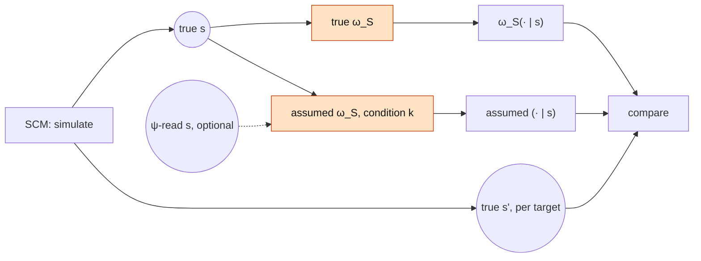

# Operator benchmark: assumed vs. true symbolic model

Status: design draft, not implemented. One of three component benchmarks of the
[wrong-symbolic-model experiment](wrong_symbolic_model.md) (reader: [reader_benchmark.md](reader_benchmark.md),
renderer: [renderer_benchmark.md](renderer_benchmark.md)). The notation, the conditions
(S1–S6, O1–O5) and the targets are defined in wrong_symbolic_model.md.

## Question

How far is the assumed operator $\tilde\omega_S$ from the true operator $\omega_S$, measured
**on states alone**? No text, no encoder, no reader, no renderer: the inputs are simulated
factual states, and the truth is the simulated counterfactual state. This isolates the
symbolic error that the end-to-end experiment then propagates into the latent space.

It costs nothing: everything is computed from the SCM and the kernels' transition matrices
(`SymbolicIntervention` precomputes a sparse $\lvert\mathcal S\rvert\times\lvert\mathcal S\rvert$
matrix per $\delta$). Many misspecifications can be screened here before any of them enters
the end-to-end runs.

## Inputs

- **True states**, sampled from the SCM in any number (no texts needed).
- **Realized counterfactual states** $\mathbf s'$ of the same units under each $\delta$ and
  target. The SCM reuses the factual noise, so they are exact.
- **Optional: $\psi$-read states** $\hat{\mathbf s}\sim\psi(\cdot\mid z)$ for the units that
  have texts. $\omega_S(\cdot\mid\hat{\mathbf s})$ vs. $\omega_S(\cdot\mid\mathbf s)$ is the
  state-level share of the reading error, which the end-to-end decomposition needs.

## Conditions

| Condition | What is compared | Notes |
|---|---|---|
| O1 | $\texttt T$-unaware kernel on the full state | unaware and refit variants (below) |
| O2★, O2a–d | estimated parameters vs. the true ones | O2★ is the zero point. O2c needs $\psi$-labelled states, so it runs after the reader |
| O3 | edge $\texttt X\to\texttt D$ or $\texttt X\to\texttt U$ dropped | against the total target |
| O4 | edge $\texttt X\to\texttt D$ blocked | against the $\{\texttt D\}$-blocked path-specific target, where it should be exact; and against the total target |
| O5 | false edge $\texttt X\to\texttt M$, $c$ swept, plus the refit variant | on S6's state space |
| S2–S5 | kernels restricted to $\mathcal S_k$ | against the true counterfactual marginalized to $\mathcal S_k$ |

### Kernel variants

"The kernel does not know $\texttt T$" (S2, S5, O1) can be built in several ways. The
closed-form kernel in `exp/sim/symbolic.py` abducts each node's noise from its observed
parents, so it is exact only when every parent is in the state.

| Variant | Construction | Assumes |
|---|---|---|
| unaware | delete $\texttt T$ from the graph, keep all other parameters | nothing about $\texttt T$; its contribution is attributed to the node's own noise (noise intervals may be inconsistent or degenerate) |
| refit | delete $\texttt T$ and re-estimate the noise (`SymbolicIntervention.fit`) | $\texttt T$ absorbed into independent per-node noise; the $\texttt D$–$\texttt U$ correlation it induces is lost |
| marginalizing | keep $\texttt T$ as a latent with its prior, abduct jointly from the observed columns | the best a kernel without observed $\texttt T$ can do; new code |

For $do(\texttt X)$ the pre-rounding shift of $\texttt D$ and $\texttt U$ is the same in all
three: $\texttt T\perp\texttt X$, so $\texttt T$ cancels in $\texttt D'-\texttt D$. Differences
come only through rounding/clipping and the $\texttt D$–$\texttt U$ correlation, and may be
small. This benchmark is where that is settled, at no cost. The marginalizing variant is
built only if unaware and refit differ from the true kernel here.

### O2: bad estimates

| | Source | Construction |
|---|---|---|
| O2★ | none (privileged) | true coefficients and noise; the zero point of every curve |
| O2a | estimator bias | `SymbolicIntervention.fit(..., fit_mechanisms=True)` on true states, large sample |
| O2b | sampling error | the same estimator on $n_{fit}$ true states, swept, several resamples per size |
| O2c | label error | the same estimator on $\psi$'s labels of the pool |
| O2d | sensitivity | multiplicative perturbation of one parameter group at a time: $\texttt X$ coefficients, $\texttt T$ coefficients, noise $\mu$, noise $\sigma$ |

- **The current estimator is biased even with infinite data.**
  [`fit`](../../exp/sim/symbolic.py) runs least squares without an intercept on rounded and
  clipped 3-level categories. The noise mean ($\mu\neq 0$) leaks into the slopes, and the
  clipping attenuates them. O2a measures this bias. The refit variants of O1 and O5 inherit it.
- **O2c is an errors-in-variables regression.** $\psi$ reads $\texttt T$ only up to its Bayes
  ceiling, which attenuates the $\texttt T$ coefficients and, through the mediators, biases the
  others. Crossed with the $n_\psi$ grid of the reader benchmark.
- **H5, state level.** The pre-rounding shift under $do(\texttt X)$ depends only on the
  $\texttt X$ coefficients. The $\texttt T$ coefficients and the noise affect mostly the
  spread of $\mathbf s'$. O2d should show the $\texttt X$ coefficients dominating.

### O5: a false mediator

Under $do(\texttt X)$, O5 shifts $\texttt M$ by $c\,\Delta\texttt X$, while the truth is
$\texttt M'=\texttt M$.

- The noise mean of the assumed $\texttt M$ mechanism is set so that its marginal matches the
  data. Otherwise the wrong model would also be visibly inconsistent with the factual
  distribution.
- **Refit check.** Refitting the coefficients estimates $c\approx 0$, because
  $\texttt M\perp\texttt X$. A false edge is detectable from factual data, and an omitted
  variable is not. This benchmark reports the estimated $c$ and how fast it shrinks with
  $n_{fit}$.

### What this benchmark cannot see

For S2–S5 the restricted kernel is evaluated on $\mathcal S_k$ only, and there it can look
perfect. S3's kernel sets $\texttt X'$ and is exact on $\{\texttt X\}$. The error of omitting a
mediator is not in $\mathcal S_k$ at all: what happens to the omitted variable is decided by
the renderer. That error is measured in the [renderer benchmark](renderer_benchmark.md) (H2)
and end-to-end, not here.

## Metrics

All per $\delta$ and target, weighted by the factual state distribution, and broken down per
factual $\texttt X$:

| Metric | Computed | Reference |
|---|---|---|
| **TV / KL to the true kernel** | $\mathbb E_{\mathbf s}\,\mathrm{TV}\big(\tilde\omega_S(\cdot\mid\mathbf s),\,\omega_S(\cdot\mid\mathbf s)\big)$, exact from the transition matrices; for $\mathcal S_k$, the true counterfactual marginalized to $\mathcal S_k$ | 0 at O2★ |
| **Log score of realized counterfactuals** | NLL of the simulated $\mathbf s'$ under $\tilde\omega_S(\cdot\mid\mathbf s)$ | the true kernel's NLL (lower bound) |
| **Mean-shift error per variable** | $\mathbb E[\texttt V'] - \mathbb E_{true}[\texttt V']$ for each changed variable $\texttt V$ | 0 |
| **Downstream at state level** | shift of the BOP prediction of $\texttt Y'$ (closed form via `outcome_posterior`) under $\tilde\omega_S$ vs. $\omega_S$ | 0 |
| **Parameter error** (O2) | relative error of each parameter group | 0 at O2★ |

Bootstrap CIs over simulated units. Sample sizes are free, so they are chosen large enough
that Monte Carlo error is negligible relative to the effects.

## Screening rule for the end-to-end runs

The end-to-end experiment tests whether latent-level error follows state-level error (H6 in
wrong_symbolic_model.md). Conditions are therefore selected here, with the rule fixed in advance:

- Every condition with a state-level TV clearly above zero enters the end-to-end runs.
- Conditions with TV indistinguishable from zero (e.g. kernel variants that turn out
  identical) enter only as a single spot check.
- The S family always enters, because its error is invisible here.

## Required changes

1. **Assumed operators.** A config-selected wrapper in `exp/sim/symbolic.py` that derives
   $\tilde\omega_S$ from the true kernel by restricting to $\mathcal S_k$ (unaware or refit),
   ignoring a variable on the full state (O1), fitting the parameters from a given frame
   (O2a–c) or scaling them per group (O2d), dropping (O3) or blocking (O4) edges, and adding an
   edge with a given coefficient and matched marginal (O5). The marginalizing variant is the
   only new inference code and is optional.
2. **True marginalized counterfactuals** for $\mathcal S_k$: by exact enumeration or Monte
   Carlo from the SCM.
3. **A runner** in `exp/benchmarks/`: conditions × $\delta$ × targets → metrics JSON and report.
   No billed calls, no encoders.

## Open decisions

- $n_{fit}$ grid and resamples (O2b), perturbation factors (O2d), $c$ grid (O5).
- Keep the biased `fit` only (the "naive practitioner" estimator), or also add a censored
  estimator (ordered probit with intercept) to separate estimator bias from misspecification.
- Whether to build the marginalizing kernel (decided by the kernel-variant result).
