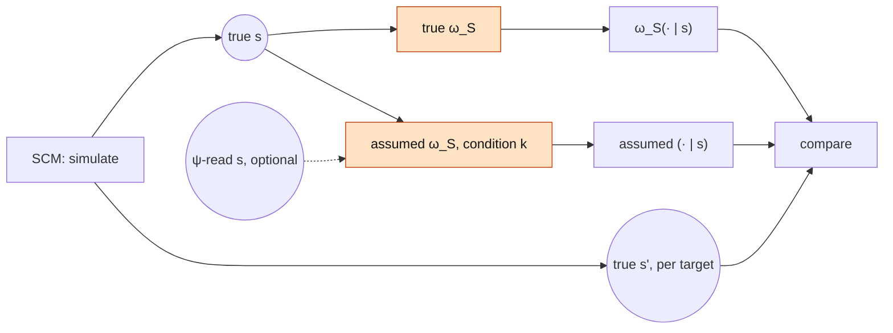

# Operator benchmark: assumed vs. true symbolic model

Status: implemented and run (`operator-v3`, results below). O2c needs the reader's labels and
is pending. One of three component benchmarks of the
[wrong-symbolic-model experiment](wrong_symbolic_model.md) (reader: [reader_benchmark.md](reader_benchmark.md),
renderer: [renderer_benchmark.md](renderer_benchmark.md)). The notation and the conditions
(S1–S6, O1–O5) are defined in wrong_symbolic_model.md, the data and targets in
[data_sim.md](data_sim.md).

## Question

How far is the assumed operator $\tilde\omega_S$ from the true operator $\omega_S$, measured
**on states alone**? No text, no encoder, no reader, no renderer: the inputs are simulated
factual states, and the truth is the simulated counterfactual state. This isolates the
symbolic error that the end-to-end experiment then propagates into the latent space.

It costs nothing: everything is computed from the SCM and the kernels' transition matrices
(`SymbolicIntervention` precomputes a sparse $\lvert\mathcal S\rvert\times\lvert\mathcal S\rvert$
matrix per $\delta$). Many misspecifications can be screened here before any of them enters
the end-to-end runs.

## Inputs

- **True states**, sampled from the SCM in any number (no texts needed).
- **Realized counterfactual states** $\mathbf s'$ of the same units under each $\delta$ and
  target. The SCM reuses the factual noise, so they are exact.
- **Optional: $\psi$-read states** $\hat{\mathbf s}\sim\psi(\cdot\mid z)$ for the units that
  have texts. $\omega_S(\cdot\mid\hat{\mathbf s})$ vs. $\omega_S(\cdot\mid\mathbf s)$ is the
  state-level share of the reading error, which the end-to-end decomposition needs.

## Conditions

| Condition | What is compared | Notes |
|---|---|---|
| O1 | $\texttt T$-unaware kernel on the full state | unaware and refit variants (below) |
| O2★, O2a–d | estimated parameters vs. the true ones | O2★ is the zero point. O2c needs $\psi$-labelled states, so it runs after the reader |
| O3 | edge $\texttt X\to\texttt D$ or $\texttt X\to\texttt U$ dropped | against the total target |
| O4 | edge $\texttt X\to\texttt D$ blocked | against the $\{\texttt D\}$-blocked path-specific target, where it should be exact; and against the total target |
| O5 | false edge $\texttt X\to\texttt M$, $c$ swept, plus the refit variant | on S6's state space |
| S2–S5 | kernels restricted to $\mathcal S_k$ | against the true counterfactual marginalized to $\mathcal S_k$ |

### Kernel variants

"The kernel does not know $\texttt T$" (S2, S5, O1) can be built in several ways. The
closed-form kernel in `exp/sim/symbolic.py` abducts each node's noise from its observed
parents, so it is exact only when every parent is in the state.

| Variant | Construction | Assumes |
|---|---|---|
| unaware | delete $\texttt T$ from the graph, keep all other parameters | nothing about $\texttt T$; its contribution is attributed to the node's own noise (noise intervals may be inconsistent or degenerate) |
| refit | delete $\texttt T$ and re-estimate the noise (`SymbolicIntervention.fit`) | $\texttt T$ absorbed into independent per-node noise; the $\texttt D$–$\texttt U$ correlation it induces is lost |
| marginalizing | keep $\texttt T$ as a latent with its prior, abduct jointly from the observed columns | the best a kernel without observed $\texttt T$ can do; new code |

For $do(\texttt X)$ the pre-rounding shift of $\texttt D$ and $\texttt U$ is the same in all
three: $\texttt T\perp\texttt X$, so $\texttt T$ cancels in $\texttt D'-\texttt D$. Differences
come only through rounding/clipping and the $\texttt D$–$\texttt U$ correlation, and may be
small. This benchmark is where that is settled, at no cost. The marginalizing variant is
built only if unaware and refit differ from the true kernel here.

### O2: bad estimates

| | Source | Construction |
|---|---|---|
| O2★ | none (privileged) | true coefficients and noise; the zero point of every curve |
| O2a | estimator bias | `SymbolicIntervention.fit(..., fit_mechanisms=True)` on true states, large sample |
| O2b | sampling error | the same estimator on $n_{fit}$ true states, swept, several resamples per size |
| O2c | label error | the same estimator on $\psi$'s cross-fitted labels of the training pool |
| O2d | sensitivity | multiplicative perturbation of one parameter group at a time: $\texttt X$ coefficients, $\texttt T$ coefficients, noise $\mu$, noise $\sigma$ |

- **The current estimator is biased even with infinite data.**
  [`fit`](../../exp/sim/symbolic.py) runs least squares without an intercept on rounded and
  clipped 3-level categories. The noise mean ($\mu\neq 0$) leaks into the slopes, and the
  clipping attenuates them. O2a measures this bias. The refit variants of O1 and O5 inherit it.
- **O2c is an errors-in-variables regression.** $\psi$ reads $\texttt T$ only up to its Bayes
  ceiling, which attenuates the $\texttt T$ coefficients and, through the mediators, biases the
  others. Crossed with the $n_\psi$ grid of the reader benchmark.
- **H5, state level.** The pre-rounding shift under $do(\texttt X)$ depends only on the
  $\texttt X$ coefficients. The $\texttt T$ coefficients and the noise affect mostly the
  spread of $\mathbf s'$. O2d should show the $\texttt X$ coefficients dominating.

### O5: a false mediator

Under $do(\texttt X)$, O5 shifts $\texttt M$ by $c\,\Delta\texttt X$, while the truth is
$\texttt M'=\texttt M$.

- The noise mean of the assumed $\texttt M$ mechanism is set so that its marginal matches the
  data. Otherwise the wrong model would also be visibly inconsistent with the factual
  distribution.
- **Refit check.** Refitting the coefficients estimates $c\approx 0$, because
  $\texttt M\perp\texttt X$. A false edge is detectable from factual data, and an omitted
  variable is not. This benchmark reports the estimated $c$ and how fast it shrinks with
  $n_{fit}$.

### What this benchmark cannot see

For S2–S5 the restricted kernel is evaluated on $\mathcal S_k$ only, and there it can look
perfect. S3's kernel sets $\texttt X'$ and is exact on $\{\texttt X\}$. The error of omitting a
mediator is not in $\mathcal S_k$ at all: what happens to the omitted variable is decided by
the renderer. That error is measured in the [renderer benchmark](renderer_benchmark.md) (H2)
and end-to-end, not here.

## Metrics

All per $\delta$ and target, weighted by the factual state distribution, and broken down per
factual $\texttt X$:

| Metric | Computed | Reference |
|---|---|---|
| **TV / KL to the true kernel** | $\mathbb E_{\mathbf s}\,\mathrm{TV}\big(\tilde\omega_S(\cdot\mid\mathbf s),\,\omega_S(\cdot\mid\mathbf s)\big)$, exact from the transition matrices; for $\mathcal S_k$, the true counterfactual marginalized to $\mathcal S_k$ | 0 at O2★ |
| **Log score of realized counterfactuals** | NLL of the simulated $\mathbf s'$ under $\tilde\omega_S(\cdot\mid\mathbf s)$ | the true kernel's NLL (lower bound) |
| **Mean-shift error per variable** | $\mathbb E[\texttt V'] - \mathbb E_{true}[\texttt V']$ for each changed variable $\texttt V$ | 0 |
| **Downstream at state level** | shift of the BOP prediction of $\texttt Y'$ (closed form via `outcome_posterior`) under $\tilde\omega_S$ vs. $\omega_S$ | 0 |
| **Parameter error** (O2) | relative error of each parameter group | 0 at O2★ |

Bootstrap CIs over simulated units. Sample sizes are free, so they are chosen large enough
that Monte Carlo error is negligible relative to the effects.

## Screening rule for the end-to-end runs

The end-to-end experiment tests whether latent-level error follows state-level error (H6 in
wrong_symbolic_model.md). Conditions are therefore selected here, with the rule fixed in advance:

- Every condition with a state-level TV clearly above zero enters the end-to-end runs.
- Conditions with TV indistinguishable from zero (e.g. kernel variants that turn out
  identical) enter only as a single spot check.
- The S family always enters, because its error is invisible here.

## Results (`operator-v3`)

Run: `uv run python -m exp.benchmarks.operator.run --run-id operator-v3` (protocol
[configs/operator_benchmark.yaml](../../configs/operator_benchmark.yaml); about 12 s). Full tables:
`reports/talent_motivation/operator_benchmarks/operator-v3/summary.md` (local; `reports/` is
ignored). All TV values are exact except the fitted rows (mean over resamples) and the log
score (50,000 simulated units).

**Sanity checks hold.** The true kernels against their own target, O4 against its
path-specific target, O5 at $c=0$, and S3/S4 restricted to their spaces all have TV exactly 0.

**1. The existing estimator is the dominant error source, not sampling.**

| Estimator (O2a, 200,000 units) | TV | rel. err. $\texttt X$ coef. | rel. err. $\sigma$ |
|---|---|---|---|
| naive (`SymbolicIntervention.fit`) | 0.263 | 0.105 | 0.553 |
| OLS with intercept | 0.268 | 0.113 | 0.562 |
| ordered-probit MLE (new) | **0.002** | 0.004 | 0.000 |

`fit` estimates $\sigma$ from the residual variance of the interior level only. For 3-level
variables those residuals lie in a window of width 1, so $\sigma$ comes out at about 0.30 instead
of 0.50. For a root-like variable (M) it collapses to the floor of 0.01, which makes every
$\texttt M = 2$ observation impossible. With the naive estimators O2b is flat at TV ≈ 0.26 for
every $n_{fit}$ (100 to 10,000). With MLE it falls from 0.11 ($n=100$) to 0.009 ($n=10{,}000$):
genuine sampling error. The ordered-probit MLE is in `exp/sim/assumed.py` (`estimator="mle"`);
`fit` itself is unchanged, because the talent pipeline depends on it.

**2. False edges are detectable from factual data only with a correct estimator.**

| O5 refit (only M's mechanism) | $\hat c$ at $n=10{,}000$ (true 0) | TV |
|---|---|---|
| naive (no intercept) | 0.428 ± 0.004 | 0.507 |
| OLS with intercept | −0.001 ± 0.006 | 0.250 (σ collapse) |
| MLE | −0.001 ± 0.008 | 0.009 |

Without an intercept, $\hat c \approx E[\texttt X]E[\texttt M]/E[\texttt X^2] = 0.43$: the
naive refit "finds" a false edge 1.4 times as strong as the true $\texttt X\to\texttt D$ edge.
The claim "a false edge is detectable, an omitted variable is not" therefore holds only for an
estimator with an intercept. With MLE, $\hat c$ is within ±0.07 at $n = 100$.

**3. Ignoring $\texttt T$ leaves the means right but the distributions wrong.**

| Condition | TV | E[D′] error | E[U′] error |
|---|---|---|---|
| O1 unaware (full state) | 0.222 | 0.012 | −0.002 |
| O1 refit, naive | 0.367 | 0.032 | 0.057 |
| O1 refit, MLE | 0.130 | −0.002 | −0.001 |
| S2 unaware ($\texttt X,\texttt D,\texttt U$) | 0.220 | 0.012 | −0.002 |
| S2 refit, MLE | 0.064 | −0.002 | −0.001 |
| S5 refit, MLE ($\texttt X,\texttt U$) | 0.002 | – | −0.001 |

As predicted, $\texttt T$ cancels in the mean shift. Contrary to the prediction that the
variants differ little, the *distributions* differ substantially: unaware attributes
$\texttt T$'s contribution to the noise and gets the spread wrong. A refit with MLE absorbs
most of it. What remains on S2 (0.064) is the $\texttt D$–$\texttt U$ correlation that only a
marginalizing kernel can keep. With a single mediator (S5) nothing remains.

**4. Parameter sensitivity (O2d, H5): $\texttt X$ coefficients dominate the mean, $\sigma$ the spread.**

| Group | TV ×0.5 / ×0.75 / ×1.25 / ×1.5 | E[D′] error ×0.5 |
|---|---|---|
| $\texttt X$ coefficients | 0.278 / 0.140 / 0.138 / 0.262 | −0.180 |
| noise $\sigma$ | 0.216 / 0.092 / 0.067 / 0.117 | 0.041 |
| $\texttt T$ coefficients | 0.119 / 0.061 / 0.062 / 0.120 | 0.010 |
| noise $\mu$ | 0.028 / 0.014 / 0.014 / 0.028 | 0.000 |

H5 holds for the mean shift and narrowly for TV. A halved $\sigma$ costs almost as much TV as
halved $\texttt X$ coefficients, but moves the means four times less.

**5. Edges and false mediators.**

- **Dropping $\texttt X\to\texttt D$ (O3) and blocking it (O4) give identical counterfactual
  states** (TV 0.440 against the total target, 0 against the path-specific one).
  $\texttt D$ has no descendant in the state, so the wrong abduction under "drop" is invisible
  here. It would matter only downstream (e.g. through $\texttt Y$) or with a mediator chain.
- **Using the total-effect operator for a path-specific question** costs TV 0.44 ($\texttt D$
  blocked) and 0.68 (direct effect only): the size of the normative choice between targets.
- **O5 is a clean dose-response:** TV 0.10 / 0.19 / 0.37 / 0.50 and E[M′] error 0.10 / 0.19 /
  0.37 / 0.51 at $c$ = 0.25 / 0.5 / 1 / 1.5 × the true $\texttt X\to\texttt D$ coefficient. The
  Bayes-optimal $\texttt Y'$ moves along with it (E[Y′] error 0.04 / 0.07 / 0.13 / 0.18): H4's
  downstream harm, at state level.

**Screening.** With exact metrics, a threshold of 0.001 admits every condition except the
references and exact variants (S3, S4, O4 against its own target). That isn't selective. See the
open decisions.

## Required changes

1. **Assumed operators — done.** [exp/sim/assumed.py](../../exp/sim/assumed.py) (generic):
   `restrict`, `drop_parents`, `block` (also `SymbolicIntervention.blocked` in
   `exp/sim/symbolic.py`), `scale`, `add_mechanism` with `matched_root_noise`, `refit`
   (estimators `naive`, `intercept`, `mle`; `only=` for single mechanisms), the exact
   `state_distribution`, and `projection`/`project` onto a column subset.
2. **True marginalized counterfactuals — done,** exactly, by projecting the full transition
   matrix with the exact factual state distribution.
3. **Runner — done.** `exp/benchmarks/operator/` (`run.py`, `metrics.py`). Tests:
   `tests/test_operator_benchmark.py`.

## Open decisions

- **Screening threshold.** 0.001 admits nearly everything. Options: a meaningful threshold
  (e.g. TV ≥ 0.05), or one representative level per group (O1 unaware and refit MLE; O2d
  $\texttt X$ and $\sigma$ at ×0.5; O3 = O4; O5 at $c$ = 0.5 and 1).
- **Marginalizing kernel.** Only S2 needs it (TV 0.064 after an MLE refit, from the lost
  $\texttt D$–$\texttt U$ correlation). Worth building only if S2 is a headline condition.
- **Which estimator the realistic O2c uses.** MLE by default. `naive` stays as the
  "practitioner" reference.
- **O2c** runs after the reader benchmark ($\psi$'s cross-fitted labels).
