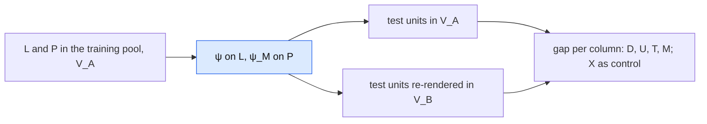

# Reader robustness to held-out verbalizations

Status: design draft, not implemented. This is an alternate version of the all-encoder
decoder benchmark ([decoder_benchmark.md](decoder_benchmark.md), run `g-all-encoders-v1`),
reduced to a robustness check of the reader. It uses the notation of
[contribution.md](../contribution.md) and is one of three component benchmarks of the
[wrong-symbolic-model experiment](wrong_symbolic_model.md) (talent SFM with motivation $\texttt M$),
next to the [operator](operator_benchmark.md) and [renderer](renderer_benchmark.md)
benchmarks.

## Notation

| Symbol | Meaning | v1 name |
|---|---|---|
| $\varphi$ | frozen text encoder | $f$ |
| $\psi(\mathbf s\mid z)$ | reader (semantic decoder) of the state $\mathbf s = (\texttt X, \texttt T, \texttt D, \texttt U)$, independent heads | $g$ |
| $\psi_{\texttt M}$ | reader head for $\texttt M$ (not in the state; the $\texttt M$ head of $\psi_{eval}$ in wrong_symbolic_model.md) | – |
| $\mathcal V_A$, $\mathcal V_B$ | the training verbalization of the codebook and a held-out paraphrase of it | – |

The autoregressive head of v1 is dropped: it showed no benefit in `g-all-encoders-v1`.

## Question

Does $\psi$ read the **meaning** of a level, or the **wording** the codebook gave it? All
texts come from one LLM, one prompt and one codebook
([exp/sim_talent_motivation/codebook.yaml](../../exp/sim_talent_motivation/codebook.yaml)).
Each $\texttt D$ and $\texttt U$ level is one fixed phrase, and each evidence level of the
talent proxies and of $\texttt M$ is one of three fixed guidance sentences, which the LLM
paraphrases closely. A reader can score well by looking up that small vocabulary. Templates and personas are drawn independently of the state, so
they are not the channel.

The check: fit $\psi$ on $\mathcal V_A$, test it on the same units rendered in $\mathcal V_A$
and in $\mathcal V_B$. The drop is the reader's dependence on wording. $\mathcal V_A$ itself
has three evidence variants per level ([data_sim.md](data_sim.md#verbalization-sets)), so the
check measures generalisation from varied training wording to unseen wording. It stays valid
as long as $\mathcal V_B$ shares no variant with $\mathcal V_A$.

## Design

### Verbalizations

$\mathcal V_B$ paraphrases only what carries $\texttt D$, $\texttt U$, $\texttt T$ (via the
$\texttt L$/$\texttt H$/$\texttt A$ evidence) and $\texttt M$. Countries and the $\texttt P$
numbers are unchanged. The set table and the paired re-rendering are specified in
[data_sim.md](data_sim.md#verbalization-sets). Each test unit is rendered in both sets with an
otherwise identical render plan, so the gap is measured within unit.

- **$\texttt X$ is a negative control.** Its wording does not change, so its accuracy should
  not drop. A drop in $\texttt X$ means the paraphrases elsewhere shift the whole
  representation (a context effect), and the other gaps must be read relative to it.
- **Calibration is checked before generating.** Without a reader fitted on $\mathcal V_B$, a
  drop cannot be separated from a paraphrase that shifts a level's intensity (a
  $\mathcal V_B$ "level 1" that reads like an $\mathcal V_A$ "level 2"). The paraphrase sets
  are therefore checked for preserved level order and spacing (LLM judge or a manual ranking
  task) before any texts are generated. $\texttt T$ needs this least: its Bayes ceiling
  (`talent_posterior_accuracy`) depends only on the proxy levels, not on their wording, so its
  gap is directly interpretable.

### Conditions

One reader per encoder, fitted and selected on $\mathcal V_A$ only, evaluated on both test
renderings. Optional: the same at a few label budgets $n_\psi$, to see whether readers fitted
on fewer labels depend more on wording (relevant for H1 in wrong_symbolic_model.md).

### Data

The texts come from the shared splits ([data_sim.md](data_sim.md#splits-and-cost)):

| Split | Verbalization | Use | Extra billed calls |
|---|---|---|---|
| training pool: $L$ / $P$ | $\mathcal V_A$ | fit $\psi$ on $L$, $\psi_{\texttt M}$ on $P$ | none |
| dev | $\mathcal V_A$ | selection and early stopping | none |
| evaluation units, factual | $\mathcal V_A$ | test, in-set | none |
| evaluation units, factual, re-rendered (seeded half, `held_out_fraction: 0.5`) | $\mathcal V_B$ | test, held-out wording | $0.5\,n_{test}$ = 500 |

Plus writing and checking the paraphrases. Every encoder in scope re-encodes the
$\mathcal V_B$ texts (compute only).

**Why 500 units.** The gap is paired by unit, so its precision depends on the share of units
read correctly in one rendering and not the other. At about 10 %, 500 units give a 95 % CI of
roughly ±2.8 points (1,000: ±2.0), and about 55 units per column × level × variant cell for the
per-variant breakdown. Any gap that would change a decision is detected. A "no gap" result is
established to about ±3 points. Raising `held_out_fraction` extends the subset and keeps the
existing texts.

## Protocol

As v1 unless stated:

- Same hyperparameter candidates, selection by validation joint NLL on $\mathcal V_A$, at
  most 500 epochs with early stopping, seeds 42–46. Selection is frozen before any test metric
  is computed. No $\mathcal V_B$ number enters selection.
- Metrics on both renderings: joint NLL, joint-MAP accuracy, joint Brier, per-column marginal
  accuracy, ECE and reliability bins. $\texttt M$ is reported per column (it is not part of
  the joint).
- **Gap** per column and joint: metric on $\mathcal V_A$ minus metric on $\mathcal V_B$, same
  units.
- **$\texttt T$ against its Bayes ceiling** on both renderings.
- **Uncertainty over units.** Per-text predictions are saved, so the paired gaps get
  bootstrap CIs over test units in addition to the seed SD (v1 reports only the latter).

## Consequence for the main experiment

Fixed before running, with a tolerance $\epsilon$ (e.g. the seed SD of the
$\mathcal V_A$ accuracy):

| Outcome | Consequence |
|---|---|
| gaps within $\epsilon$ for $\texttt D$, $\texttt U$, $\texttt T$, $\texttt M$ | $\psi$ reads meaning; $\psi_{eval}$ is fitted on $P$ in $\mathcal V_A$, like $\psi$ on $L$ |
| clear gaps | $\psi$ is wording-bound. Report it in "Meaning of the results" (wrong_symbolic_model.md). $P$ gets an additional $\mathcal V_B$ rendering (+1,000 calls) used only by $\psi_{eval}$, and $\psi_{eval}$'s accuracy on $\mathcal V_A$ texts is measured before use |

The second row is the only case in which a reader fitted on $\mathcal V_B$ is needed.

## What this does not cover

- **The generator's own style.** Both renderings come from the same LLM and prompt.
- **Encoder world knowledge** ($\texttt X$ through unseen countries), deliberately excluded.
- **Wording in real CVs.** One paraphrase set is a closed vocabulary, so the gap is a lower
  bound on the real-world gap.

## Required changes

1. **Codebook — written.** [codebook_vb.yaml](../../exp/sim_talent_motivation/codebook_vb.yaml)
   (`codebook_held_out` in the config): new `columns` phrases for $\texttt D$, $\texttt U$ and
   three new `evidence` variants per level for $\texttt L$, $\texttt H$, $\texttt A$,
   $\texttt M$; everything else identical. Disjointness and layout are tested. The paraphrase
   calibration check (level order and spacing) is still pending.
2. **Text generation — done.** `generate-held-out-texts`: the evaluation units' factual state
   with `codebook_held_out` and the identical render plan, resumable like the other billed
   stages; checked by `validate-pairs`.
3. **Benchmark.** In `exp/benchmarks/semantic_decoder/`: independent heads only, an
   $\texttt M$ head, a second test rendering, saved per-text predictions, the paired bootstrap,
   and a run ID distinct from `g-all-encoders-v1`.

## Open decisions

- Encoders in scope: all 18 latent spaces as in v1, or the best width per backend.
- Whether to include the optional $n_\psi$ sweep.
- How paraphrase calibration is checked (LLM judge vs. manual).
- The tolerance $\epsilon$.
