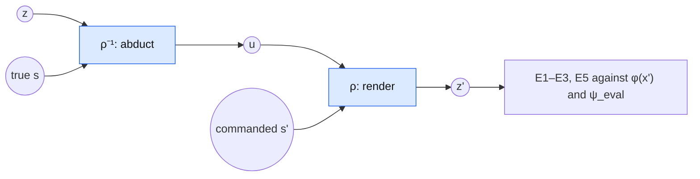

# Renderer benchmark: rendering commanded states

Status: design draft, not implemented. One of three component benchmarks of the
[wrong-symbolic-model experiment](wrong_symbolic_model.md) (reader: [reader_benchmark.md](reader_benchmark.md),
operator: [operator_benchmark.md](operator_benchmark.md)). The notation, the conditions
and the metrics E1–E6 are defined in wrong_symbolic_model.md, the data and targets in
[data_sim.md](data_sim.md).

## Question

Given the **right inputs**, how well does $\rho$ put a state into the latent while keeping
everything else? The reader and the operator are replaced by the truth: abduction uses the
true factual state $\mathbf s$, and $\rho$ renders a **commanded** target state
$\mathbf s'$. This isolates the rendering error (R1 fidelity, R2 preservation, R3 support in
contribution.md).

This benchmark is privileged by construction, like A★ in wrong_symbolic_model.md. Its numbers are
ceilings for the deployed pipeline, not estimates of it.

## What is commanded

| Commanded $\mathbf s'$ | Text-based truth | Tests |
|---|---|---|
| **True counterfactual state** (total target), full state space | $\varphi(x')$ | rendering error proper: E2, E3 at state level for every $\delta$; E1, E5 on the one text per unit |
| **True path-specific state** ($\texttt D$ held), full state space | none | blocking works when the mediator is in the state (the O4 side of H2): E2, E3 against the simulated path-specific state |
| **True counterfactual on $\mathcal S_k$** with $\rho$ fitted on $\mathcal S_k$ (S2–S5) | $\varphi(x')$ for E1, E5 | **H2: omission is not blocking**. Does the omitted mediator move with $\texttt X$ (towards its total-target value) or stay (its path-specific value)? E3, against both simulated values |
| **Identity**, $\mathbf s'=\mathbf s$ | none | exact preservation ($z'=z$ for F1) |
| **Wrong states**: the outputs of O-condition operators, e.g. $\texttt M$ shifted (S6's $\rho$) | none | **"renders what it is told"**: fidelity to the commanded state, i.e. $\psi_{eval}(z')$ vs. $\mathbf s'$ (the $\rho$ part of H4) |
| **Rare or unseen states**, grouped by their training frequency | none | fidelity vs. state frequency: where the support requirement (R3) bites |

Only E1 (proximity) and E5 (shared residual) need a counterfactual text, and only the total
target has one (one text per evaluation unit, see
[data_sim.md](data_sim.md#what-needs-texts)). Everything else is fidelity or preservation
against simulated states. That is also how operators without paired truth (erasure, rules;
contribution.md evidence items 3–4) are evaluated.

### Omission is not blocking (H2)

F1 abducts $u=\rho^{-1}(z;\mathbf s_k)$, the position of $z$ within $p(z\mid\mathbf s_k)$, and
renders $z'=\rho(u;\mathbf s'_k)$. An omitted mediator is part of $u$, but its dependence on
$\texttt X$ is part of $p(z\mid\mathbf s_k)$. Changing $\texttt X$ therefore moves it as a
transport $p(z\mid\mathbf s_k)\to p(z\mid\mathbf s'_k)$ would (De Lara et al. 2024; cf.
fairadapt). That is right for $x'_{tot}$, to the extent the transport's coupling matches the
SCM's noise, and wrong for $x'_{ps}$. Holding a mediator fixed requires it in the state plus a
blocking command (row 2).

- **Measured by** $\psi_{eval}$ on the omitted mediator in $z'$, against its factual value and
  against its total-target value (E3).
- **E5** tests whether the shared residual is the right coupling. Shared $u$ is an assumption,
  not identified by factual data (Nasr-Esfahany et al. 2023).
- **S3 vs. N2** (target-group OT map) compares two transports with different couplings. If F1
  matches N2, the shared-residual story reduces to generic transport.

### Preservation of $\texttt M$ (H3)

$\texttt M$ is in the residual for every state space except S6. Under every commanded
$\mathbf s'$ the truth is $\texttt M'=\texttt M$, so $\psi_{eval}$'s $\texttt M$ reading on
$z'$ should match its reading on $z$. On S6 the same holds by command instead of by
preservation.

## Renderers compared

Only methods that turn a target into a latent without a reader or an operator in training:

| Renderer | Input | Notes |
|---|---|---|
| F1 (state-conditioned flow) | $\mathbf s$, $\mathbf s'$ | main renderer |
| C-sym | $\mathbf s'$ | **not implemented** yet |
| Constant direction | $\delta$ | $z'=z+v_\delta$; ignores the state |
| N2, target-group OT map | $\texttt X'$ | transport baseline |
| Identity | – | lower reference |
| $\varphi(x')$ | – | upper reference where a text exists; E2's reference is $\Gamma$, E1's the noise floor |

The residual transformer is trained against $\tilde\omega_S\circ\psi$, so it has no
reader-free version and is evaluated only end-to-end.

## Fitting

$\rho$ is fitted on the whole training pool (2,800 units) with **true** states (privileged; Variation A's
pseudo-label conditions belong to the end-to-end experiment). One $\rho$ per state space: S1,
S2–S5, S6. No new texts: E1 and E5 use the evaluation units' counterfactual texts
([data_sim.md](data_sim.md#splits-and-cost)).

## Metrics

E1 (fraction of the gap closed, support), E2 (fidelity against $\Gamma$ from factual latents),
E3 (preservation), E5 (shared residual), as defined in wrong_symbolic_model.md. E6 (text)
optionally. E2 for a commanded state is *fidelity to the command*: $\psi_{eval}(z')$ vs. the
commanded $\mathbf s'$, against $\Gamma(\cdot\mid\mathbf s')$; reading *better* than real
latents flags off-manifold rendering. Additionally:
- **Fidelity vs. state frequency**, binned by how often $\mathbf s'$ occurred in $\rho$'s
  training data.

## Required changes

1. **Rendering with commanded states** in the flow workflow: abduct with a given $\mathbf s$,
   render a given $\mathbf s'$, bypassing $\psi$ and $\omega_S$.
2. **$\rho$ per state space**, fitted on true states; $\texttt M$ in the schema for S6.
3. **$\psi_{eval}$**, the support distance, flow inversion for E5, $\Gamma$ estimated per state,
   state-frequency bins.
4. **A runner** in `exp/benchmarks/`, reusing the evaluation units of the end-to-end
   experiment.

## Open decisions

- How rare states are sampled for the support rows (all unseen states, or a fixed number per
  frequency bin).
- Whether C-sym is implemented before this benchmark runs, or added later.
