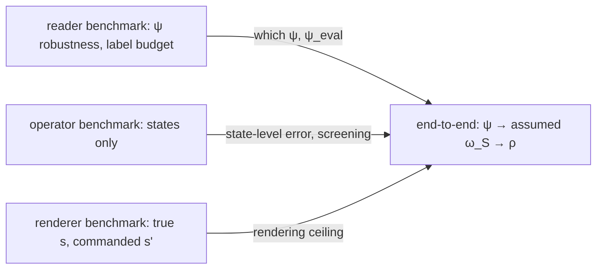
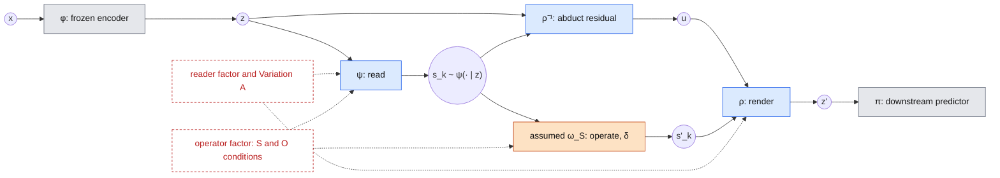
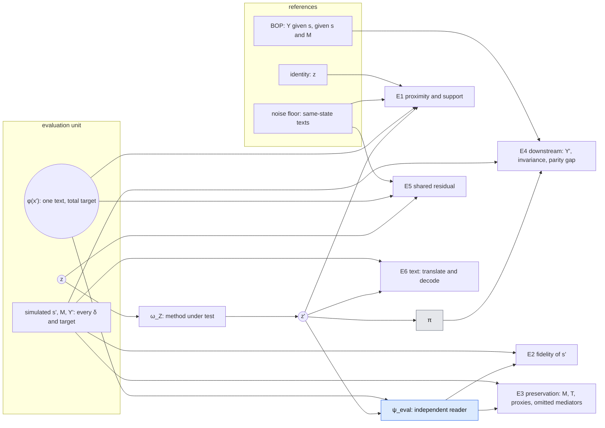

# Experiment: assuming a wrong symbolic model

Status: design draft. Nothing here is implemented yet; the code it requires is listed in
[Required changes](#required-changes).

This doc defines the conditions, the metrics and the **end-to-end** experiment. The DAG, the
counterfactual targets, text generation and splits are in [data_sim.md](data_sim.md). Three
component benchmarks isolate one part each, with the truth substituted for the others:

| Benchmark | Isolates | Doc |
|---|---|---|
| Reader | $\psi$: robustness to wording, label budget | [reader_benchmark.md](reader_benchmark.md) |
| Operator | $\tilde\omega_S$ vs. $\omega_S$ on states alone; free | [operator_benchmark.md](operator_benchmark.md) |
| Renderer | $\rho$ given true $\mathbf s$ and a commanded $\mathbf s'$ | [renderer_benchmark.md](renderer_benchmark.md) |
| End-to-end | $\psi\to\tilde\omega_S\to\rho$, and how the component errors combine | this doc |

## Notation

Follows [contribution.md](../contribution.md): Greek letters for functions, Latin letters for
variables, $\texttt{typewriter}$ for SCM variables. Additions:

| Symbol | Meaning |
|---|---|
| $\varphi$, $\psi$, $\rho$ / $\rho^{-1}$, $\omega_Z$, $\pi$ | encoder, reader, renderer / abduction, latent operator, downstream predictor (as in contribution.md) |
| $\omega_S$ | the **true** operator: the SCM counterfactual |
| $\tilde\omega_S$ | the **assumed** operator, possibly wrong |
| $\mathcal S_k$, $\mathbf s_k$ | the assumed state space of condition $k$ and a state in it |
| $\delta$ | the intervention, always $do(\texttt X = k)$ |
| $z' = \omega_Z(z)$ | edited latent |
| $\varphi(x')$ | latent of the real counterfactual text (evaluation only) |
| $x'_{tot}$, $x'_{ps}$ | the total-effect and the path-specific counterfactual (simulated as states for every unit; only $x'_{tot}$ is rendered as text) |
| $\psi_{eval}$ | independent evaluation reader, never used by any method |
| $n_\psi$ | label budget: number of state-labelled texts used to fit $\psi$ |
| E1–E6 | evaluation metrics; R1–R3 are the renderer requirements of contribution.md |

## Question

1. **States are cheap.** Only a small amount of state-labelled text is needed to fit $\psi$,
   which then labels the factual pool on which $\rho$ is fitted.
2. **$\tilde\omega_S$ may be wrong.** The symbolic model we write down is rarely the true
   data-generating process. How gracefully does $\omega_Z$ degrade, and what does the shared
   residual $u$ recover of what the symbolic model leaves out?

This covers evidence items 1 and 2 of contribution.md (total effect, path-specific
counterfactual). Because $\rho$ never sees an operator (R3), every operator condition that
keeps the state space reuses one trained $\psi$ and $\rho$.

| # | Hypothesis | Supported if | Where |
|---|---|---|---|
| H1 | A small $n_\psi$ suffices | E1, E2 and E4 at small $n_\psi$ lie within the seed spread of $n_\psi$ = all | reader (groundwork), end-to-end (Variation A) |
| H2 | Omitted mediators are moved by transport, i.e. towards the total-effect target | $\psi_{eval}$ reads the total-target $\texttt D'$, $\texttt U'$ from $z'$ better than the factual $\texttt D$, $\texttt U$ | renderer |
| H3 | Variables outside the state that matter for $\texttt Y$ are preserved under $do(\texttt X)$ | $\texttt M$ is read from $z'$ as accurately as from $z$ | renderer; end-to-end under $\psi$ |
| H4 | A false mediator in $\tilde\omega_S$ is rendered faithfully, so the error reaches downstream predictions | the shift in $\psi_{eval}$'s $\texttt M$ and in $\pi(z')$ grows with the assumed coefficient and vanishes at 0 | renderer (fidelity to the command), end-to-end (E4) |
| H5 | Under a correct DAG, the cost of estimated parameters is dominated by the $\texttt X$ coefficients | the response to perturbing the $\texttt X$ coefficients is clearly larger than to the $\texttt T$ coefficients or the noise | operator (state level), end-to-end (propagation) |
| H6 | The latent-level error of $\tilde\omega_S$ follows its state-level error | high rank correlation across O conditions between the operator benchmark's error and the end-to-end E2/E4 error; outliers explained by state support | operator vs. end-to-end |

Thresholds ("within the seed spread", "clearly larger", "high") are fixed before running.

## Setup

### Data

The DAG, structural equations, counterfactual targets, text generation, splits and costs are in
[data_sim.md](data_sim.md). In short:

- **DGP:** the talent SFM ($\texttt X$ origin, hidden $\texttt T$ talent read through proxies,
  mediators $\texttt D$, $\texttt U$, outcome $\texttt Y$), extended by **$\texttt M$
  (motivation)**. $\texttt M$ is a root, a parent of $\texttt Y$ only, verbalized, and not in
  the state except in S6/O5. It puts $\texttt Y$-relevant information into the residual $u$.
- **Training needs factual texts only.** Three partitions, disjoint by unit: a training pool
  (2,800), dev (200) and evaluation units (1,000). Inside the pool, $\psi$ may see the labels of
  a subset $L$ (up to 1,000, nested for the $n_\psi$ grid) and $\psi_{eval}$ those of a disjoint
  subset $P$ (1,000). $\rho$ is fitted on the whole pool.
- **Most metrics need no counterfactual text.** E2–E4 compare readings of $z'$ with the
  simulated truth, for every unit, every $do(\texttt X=k)$ and every target. Only E1
  (proximity) and E5 (shared residual) need $\varphi(x')$.
- **Evaluation units** therefore get one counterfactual text each (total target, random
  non-identity $k$), and a 20 % subset gets a noise-floor text.
- **Cost:** $N + 1.7\,n_{test}$ billed calls. A new operator or target costs nothing.

### Method

Colours as in contribution.md (grey frozen, blue learned once from factual data, orange
user-defined), red dashed = experimental factor. The chart shows F1 (read–abduct–render). For
C-sym, abduction is implicit in $z$.

## Conditions

### Variation A: where the states come from

| Condition | $\psi$ fitted on | $\rho$ fitted on | $\mathbf s$ at inference |
|---|---|---|---|
| A★ privileged | not used | whole pool, true $\mathbf s$ | true $\mathbf s$ |
| A1 oracle | $L$ | whole pool, true $\mathbf s$ | $\psi$ |
| A2 inferred | $L$ (1,000) | whole pool, cross-fitted $\psi$-labels | $\psi$ |
| A3 label budget | $n_\psi$-subset of $L$, swept | whole pool, cross-fitted $\psi$-labels | $\psi$ |
| A2/A3, practitioner variant | as A2/A3 | true $\mathbf s$ on $L$, cross-fitted $\psi$-labels elsewhere | $\psi$ |

- **A★ is the renderer benchmark's setting.** Here it is the ceiling of the end-to-end grid.
- **A1 is not a ceiling.** $\rho$ is fitted on true $\mathbf s$ but used with $\psi$'s reading,
  a train/inference mismatch that A2 does not have. It matters most for $\texttt T$, which
  $\psi$ reads only up to the Bayes ceiling (`talent_posterior_accuracy`).
- **A3 is a curve:** $n_\psi$ on a geometric grid down to a few dozen texts, per encoder.
  $\rho$'s training units stay the same (the whole pool); only the quality of its labels changes.
- **Pseudo-labels are cross-fitted and sampled.** Each fold of the pool is labelled by a $\psi$
  fitted on the $L$-units of the other folds, so $\rho$ never sees $\psi$'s in-sample (too clean)
  predictions. Labels are samples $\mathbf s\sim\psi(\cdot\mid z)$ rather than
  $\arg\max\psi$, so $\psi$'s uncertainty is kept (contribution.md, "Reading is uncertain").
  Details: [data_sim.md](data_sim.md#who-is-fitted-on-what).
- **The practitioner variant** uses the true states where they exist. It is what one would do
  in practice; A2/A3 isolate the pseudo-label effect.

### Variation B: assumed symbolic model

**State-space conditions.** The state space lacks variables. $\psi$ gets heads for
$\mathcal S_k$ only, and $\rho$ is refitted conditioned on $\mathbf s_k$ (compute only, no new
texts).

| Condition | $\mathcal S_k$ | Missing | Mediator paths known to $\tilde\omega_S$ |
|---|---|---|---|
| S1 | $\texttt X, \texttt T, \texttt D, \texttt U$ | nothing (reference) | $\texttt D$, $\texttt U$ |
| S2 | $\texttt X, \texttt D, \texttt U$ | $\texttt T$: $\texttt D$ and $\texttt U$ share an unmodelled cause | $\texttt D$, $\texttt U$ |
| S3 | $\texttt X$ | both mediators | none |
| S4 | $\texttt X, \texttt T, \texttt U$ | $\texttt D$ | $\texttt U$ |
| S5 | $\texttt X, \texttt U$ | $\texttt T$, $\texttt D$ | $\texttt U$ |
| S6 | $\texttt X, \texttt T, \texttt D, \texttt U, \texttt M$ | nothing; $\texttt M$ added, correct operator leaves it alone | $\texttt D$, $\texttt U$ |

S6 is the reference for O5. It moves $\texttt M$ from the residual into the state, so
$\texttt M$ is kept by the operator rather than by R2.

**Operator conditions.** The state space is complete and only $\tilde\omega_S$ is wrong. O1–O4
reuse S1's $\psi$ and $\rho$, and O5 reuses S6's. Nothing is refitted (operator exchange,
R3). Construction details are in the [operator benchmark](operator_benchmark.md).

| Condition | $\tilde\omega_S$ | Status |
|---|---|---|
| O1 | $\texttt T$-unaware: $\texttt T$ is read, the kernel ignores it (unaware / refit variants) | wrong |
| O2★, O2a–d | correct DAG; true (★), or estimated with bias, sampling error, label error, or perturbed | wrong by estimation (except ★) |
| O3 | edge $\texttt X\to\texttt D$ or $\texttt X\to\texttt U$ **dropped** from the model | wrong |
| O4 | edge $\texttt X\to\texttt D$ **blocked** (abduct under the true edge, predict with the parent's factual value) | correct path-specific operator |
| O5 | **false edge** $\texttt X\to\texttt M$, coefficient $c$ swept ($c=0$ is S6), plus a refit variant | wrong |

S2 and O1 are two readings of "the model does not know $\texttt T$". In S2 the state cannot
hold it, so it ends up in $u$. In O1 the state holds it but the operator ignores it. Comparing
them separates a representational gap from an operator gap. In a fairness reading, O5 builds a
stereotype ("motivation differs by origin") into the symbolic model.

### Targets

Every condition is evaluated against the **total** target and, where it has one, its
**path-specific** target. Definitions and simulation: [data_sim.md](data_sim.md#targets). Both
exist as simulated states for every unit, so E2–E4 cover both. E1 and E5 exist only for the
total target, the only one rendered as text.

| Condition | Path-specific target (blocked mediators) |
|---|---|
| S3 | $\{\texttt D, \texttt U\}$: direct effect only |
| S4, S5, O4 | $\{\texttt D\}$ |
| S1, S2, S6, O1, O2, O3, O5 | none: $\texttt T$ and $\texttt M$ are not descendants of $\texttt X$, so their omission or misuse changes the model, not the target |

Which target is right is a normative choice (which paths are unfair), not an empirical one.
Both are reported, and neither is preferred.

## End-to-end experiment

### Substitution grid

In the simulation each component can be replaced by the truth. The end-to-end runs therefore
form a grid, with the renderer benchmark as its privileged corner:

| | true operator $\omega_S$ | assumed operator $\tilde\omega_S$ |
|---|---|---|
| **true $\mathbf s$** (A★) | rendering error only (= renderer benchmark) | + operator error |
| **$\psi$-read $\mathbf s$** (A1–A3) | + reading error | deployed pipeline |

For a metric $m$ (e.g. E1 or E4 error):

- reading cost = $m(\psi,\omega_S) - m(\mathbf s,\omega_S)$;
- operator cost = $m(\mathbf s,\tilde\omega_S) - m(\mathbf s,\omega_S)$;
- interaction = $m(\psi,\tilde\omega_S) - m(\psi,\omega_S) - m(\mathbf s,\tilde\omega_S) + m(\mathbf s,\omega_S)$.

Bootstrapped over units like all other metrics.

### Interactions the components cannot show

These are the reasons the end-to-end runs exist at all:

- **Uncertainty propagation.** $\psi$'s posterior over $\texttt T$ is sampled into the
  operator's abduction. How that spreads $\mathbf s'$ exists only when both are present.
- **Support.** A wrong operator can command states that are rare or unseen in $\rho$'s training
  (O5 at large $c$, or combinations O3 produces). The renderer benchmark's fidelity-vs-frequency
  curve predicts where, and the end-to-end shows whether it happens.
- **Correlated errors.** O2c fits the operator on $\psi$'s labels and then applies it to
  $\psi$'s readings. Errors may compound, or cancel because they are consistent.
- **H6.** If latent-level error follows state-level error across the O conditions, the cheap
  operator benchmark predicts the expensive end-to-end result. Outliers point to the support
  interaction.

### Cells to run

- **Operator benchmark first**, as the screening step: every O condition with a clear
  state-level error, and the whole S family (its error is invisible at state level).
- **Grid** at S1 for all screened O conditions (both readers, both operators).
- **Variation A** swept at S1 with the true operator.
- **S family** at A2 and A★, each against its targets.
- **O5** as a sweep over $c$ plus its refit variant; **O2a–d**, with O2c crossed with the
  $n_\psi$ grid.
- **Corners:** A1×S2, A1×S3, smallest $n_\psi$ × S3.

### Models and baselines

| Model | Role | Per operator | Renderer benchmark |
|---|---|---|---|
| State-conditioned flow (F1) | main renderer; $\rho$ fitted by conditional likelihood on factual $(z, \mathbf s)$ | reused | yes |
| C-sym | state realiser; **not implemented** yet, see [background.md](../background.md) | reused | yes |
| Identity, $z' = z$ | lower reference for every metric | – | yes |
| Real counterfactual, $z' = \varphi(x')$ | upper reference for E4 where a text exists; E2's reference is $\Gamma$, E1's the noise floor | – | yes |
| Residual transformer | trained against $\tilde\omega_S\circ\psi$; exposes adversarial edits against $\psi$; violates R3 | retrained | no |
| Constant direction per $\delta$ | $z' = z + v_\delta$, $v_\delta$ from factual group means (by $\psi$'s $\texttt X$) | reused | yes |
| LEACE | strongest linear erasure; erasure, not a counterfactual | – | no |
| N1 label relabeling | non-causal reference, see below | – | no |
| N2 feature massaging | non-causal reference, see below | – | target-group map |

#### Non-causal references

N1 and N2 are classical fairness pre-processing methods that need no SCM. They target group
parity, not individual counterfactual consistency, so they show what an SCM-free pipeline
achieves and where the two criteria come apart on paired data.

| | Acts on | Idea | Output |
|---|---|---|---|
| N1 label relabeling | $\texttt Y$ | relabel the training labels so that $\tilde{\texttt Y}\perp\texttt X$ (massaging, Kamiran & Calders†; for the 3-tier $\texttt Y$: group-wise quantile matching to a common marginal), then fit $\pi$ on $(z, \tilde{\texttt Y})$. Variant: an independence penalty (MMD/HSIC) on $\pi(z)$ | a predictor; no latent |
| N2 feature massaging | $z$ | repair $z$ so its distribution is equal across $\texttt X$: a map to the pooled distribution (Feldman et al.†), or an optimal-transport map $p(z\mid x)\to p(z\mid x')$ to the target group | a latent |

- **Group membership** comes from the true $\texttt X$ or from $\psi$ (Variation A applies).
- **N1** enters only E4. Every other metric is "n/a" for it, not zero.
- **N2, target-group map**, is a plain transport and enters E1–E4. Pooled, it yields invariance
  only and enters E3 and E4.
- **Framing:** a comparison of criteria, not a win on their task. The claim is "parity does
  not imply counterfactual consistency", measurable here because the data are paired.

## Measurement

Shared by the renderer benchmark and the end-to-end runs.

| Metric | Question | Computed | Reference |
|---|---|---|---|
| E1 proximity and support | Does $z'$ land near the real counterfactual latent, and on the manifold? Catch-all for damage to content no reader probes (style, persona, length) | **fraction of the gap closed**, $\big(d(z,\varphi(x')) - d(z',\varphi(x'))\big)\,/\,\big(d(z,\varphi(x')) - d_{floor}\big)$, with $d$ = L2 or cosine (energy distance over $\mathbf s\sim\psi$ draws for the distributional version): 0 = identity, 1 = as close as the floor allows. Raw distances are dominated by style and are reported only alongside. Support: distance to real factual latents with state $\mathbf s'$. Total target only | [noise floor](data_sim.md#noise-floor) $d_{floor}$, identity |
| E2 fidelity (R1) | Is the target state realized, as well as in a real latent? | $\psi_{eval}(z')$ vs. the simulated $\mathbf s'$, compared with $\Gamma(\cdot\mid\mathbf s')$: $\psi_{eval}$'s confusion on **factual** latents whose state is $\mathbf s'$ (contribution.md, R1). The target is to be read exactly as well as a real latent; reading *better* flags off-manifold edits. No counterfactual text needed | $\Gamma$ from factual latents, $\texttt T$ Bayes ceiling |
| E3 preservation (R2) | Is what should not change unchanged? | $\psi_{eval}$ on $z'$ for $\texttt M$, $\texttt T$, the proxies and any mediator omitted from $\mathcal S_k$, against the value under the evaluated target: $\texttt M'=\texttt M$, $\texttt T'=\texttt T$ always; omitted mediators keep their factual value under $x'_{ps}$ and change under $x'_{tot}$; identity check $\mathbf s'=\mathbf s\Rightarrow z'=z$ | $\psi_{eval}$ on $z$ |
| E4 downstream | Does $\pi$ behave counterfactually correctly? | $\pi$ fitted on factual $(z, \texttt Y)$. $\pi(z')$ vs. $\texttt Y'$ (fidelity), $\pi(z')$ vs. $\pi(z)$ (invariance), group-parity gap (spread of $E[\pi(z')\mid\texttt X]$ across $\texttt X$); report fidelity and invariance separately | BOP: $\texttt Y$ given $\mathbf s$ and given $(\mathbf s, \texttt M)$, closed form via `outcome_posterior`; $\pi(z)$; $\pi(\varphi(x'))$ where a text exists; N1, N2 |
| E5 shared residual | Is $u$ preserved by $do(\texttt X)$? | $\lVert\rho^{-1}(z;\mathbf s) - \rho^{-1}(\varphi(x');\mathbf s')\rVert$ with each condition's own $\rho$ and states; F1 only | noise-floor texts, shuffled pairs |
| E6 text | Can $x'$ be read back from $z'$? | a translation module (fitted on factual latents) maps $z'$ into a decodable LangVAE latent; decode and check $\mathbf s'$ and $\texttt M$ with $\psi_{eval}$ on the re-encoded text or the validators | the same pipeline on $\varphi(x')$ |

**$\psi_{eval}$ instead of $\psi$.** In the state-space family each condition's $\psi$ reads a
different state (S3's reads only $\texttt X$), so E2 and E3 would not be comparable across
conditions. Using the training reader would also make E2 partly circular.

**Statistics.** Bootstrap CIs over evaluation units. Paired tests between conditions (same
units throughout), at least three seeds for $\psi$/$\rho$, and a breakdown per factual
$\texttt X$, per $\delta$ and per target. E2–E4 are computed for every unit under every
$\delta$, so comparisons between interventions are within unit. For E1 and E5 (one text per
unit) they are between units. The identity check ($\delta$ with $k = x_i$) needs no text.

## Meaning of the results

The simulation exists because only here is the truth known: the SCM, the counterfactual state
and a real counterfactual text. That same property limits what the numbers mean for real
data. This section fixes in advance which kinds of claims the experiments can support.

### What transfers and what does not

| Claim type | Example | Transfers? |
|---|---|---|
| **Mechanism**: a structural property of the method, independent of the numbers | omission is not blocking (H2); a false mediator is rendered faithfully (H4); a false edge is detectable from factual data but an omitted variable is not (O5 refit) | yes; follows from how $\rho$ and $\tilde\omega_S$ are built, the simulation demonstrates it |
| **Ordering / relative sensitivity** | $\texttt X$ coefficients matter more than noise (H5); omission costs more than estimation error | with care; holds for this SCM's effect sizes; state-level orderings are checked in alternative worlds (below) |
| **Decomposition**: which component dominates the error | reading vs. operator vs. rendering cost from the substitution grid | as an ordering, with the same care |
| **Diagnostic validity**: whether a metric computable without ground truth tracks one that needs it | support distance and $\psi$-consistency against $\Gamma$ predict E1/E3/E4 | yes, and this is the main bridge (below) |
| **Magnitude** | "E4 drops by 0.08 in S3"; "$n_\psi = 200$ suffices" | no; depends on the simulated world, the generator and the encoder |

Results are phrased as "under a known SCM, …" and as mechanisms and orderings, not as
magnitudes.

### Where the simulation is kinder than reality

| In the simulation | In real data | Consequence |
|---|---|---|
| States are exact and free; the label budget is imposed by subsampling | annotations are noisy, ambiguous, costly | H1's $n_\psi$ is a lower bound; real budgets are larger |
| $\texttt T$ has true labels, so $\psi$ can learn to read it | talent is never labelled; only proxies or tests exist | S1 is *privileged* in practice; S2 (no $\texttt T$ in the state) is the realistic default. The S1–S2 gap is what a hidden variable costs |
| The true parameters exist and can be fitted from true states | the SCM comes from domain knowledge or from data without hidden variables | O2a/b are optimistic; O2c and O2d (sensitivity) are the transferable part |
| $\texttt X$ is a root, independent of $\texttt T$ | origin is confounded with background, age, socio-economic status (the SFM's spurious path) | conditional differences $p(z\mid x)$ vs. $p(z\mid x')$ contain no spurious part here, so **transport-based results (H2, N2, F1 at S3) are favoured**. With confounding, transport also moves what the counterfactual should keep. Not tested here; a stated limitation |
| Linear-Gaussian mechanisms, 3–4 levels, $\lvert\mathcal S\rvert$ around 100 | nonlinear, interacting, high-cardinality or continuous states | almost every target state is seen in training (R3 support); in reality many are not, and $\rho$ extrapolates |
| One misspecification at a time, of known type and size | several, combined, unknown | the conditions give a vocabulary of failure modes, not an error budget |
| Texts are rendered by one LLM from a known state plus persona/template | real CVs: selection, formatting, length, many unstated signals | the residual is small and stylised; $\texttt M$ is the only $\texttt Y$-relevant non-state content |
| $\texttt X$ appears through the codebook phrases | origin leaks through names, institutions, language, spelling | editing $\texttt X$ "completely" is ill-defined in real text; the counterfactual text $x'$ is the LLM's notion of the counterfactual person |
| $\texttt Y$ is generated by a known mechanism; BOP is closed form | historical labels carry their own bias | E4 fidelity to $\texttt Y'$ has no real-world analogue; invariance and the parity gap do |

### Generator coupling

All texts come from one LLM, one prompt and one codebook. A reader can therefore learn the
codebook's *wording* of a level rather than its meaning. This affects the readers ($\psi$ and
$\psi_{eval}$), not the comparison with $\varphi(x')$, which shares the verbalization of $x$ by
design.

- **Templates and personas are not the channel.** They are drawn independently of the state,
  so disjoint template/persona sets do not address this.
- **The codebook is the channel.** The [reader robustness check](reader_benchmark.md) fits
  $\psi$ on the training verbalization and tests it on the same units re-rendered with
  paraphrased $\texttt D$/$\texttt U$ phrases and $\texttt T$/$\texttt M$ evidence. A small gap
  means $\psi$ reads meaning, and $\psi_{eval}$ can share $\psi$'s verbalization. A large gap
  is a result for this section and moves $\psi_{eval}$ to the paraphrased wording.
- **Not covered: the generator's own style.** A second generator for the evaluation texts
  would test it, and stays optional.

### Robustness across worlds

One SCM parameterisation is one world. Mechanism claims do not need more. Ordering claims are
mostly state-level, so the operator benchmark checks them in alternative parameterisations for
free (asymmetric mediators, a nonlinear mechanism; [data_sim.md](data_sim.md#alternative-worlds)).
No alternative world gets texts. A confounded-origin world, the one that would test the
transport result where it should fail, is a stated limitation (table above), not part of the
plan.

### The bridge: validating real-world diagnostics

On real data only diagnostics without paired ground truth are available:

- $\psi$-consistency against $\Gamma$, estimated from factual labelled data;
- the support distance;
- the identity check;
- the refit check for false edges;
- invariance and the parity gap of $\pi$.

Every condition here produces both these diagnostics *and* the ground-truth metrics (E1, E3,
E4 fidelity, E5). Across all conditions, report how well each diagnostic ranks the conditions
by their ground-truth error (rank correlation, and false-alarm and miss rates at a threshold).
This is the result that carries over to real data unchanged: which diagnostics can be trusted
when the truth is not available, and which failure modes they miss. Omission (H2) is the
expected blind spot, since a renderer that moves an omitted mediator looks perfectly
consistent to a reader of $\mathcal S_k$.

## Required changes

Shared and end-to-end; each component doc lists its own.

1. **Data:** sibling config, $\texttt M$, codebook sets, per-unit counterfactuals with
   blocked edges, noise-floor texts. See [data_sim.md](data_sim.md#required-changes).
2. **Label roles and cross-fitting.** $\psi$ on $L$ or its $n_\psi$ subsets; cross-fitted,
   sampled pseudo-labels for $\rho$; the per-condition label flag for $\rho$ (partitions in
   [data_sim.md](data_sim.md#partitions)).
3. **End-to-end runner.** The substitution grid (true or $\psi$-read states × true or assumed
   operator) on shared evaluation units, the decomposition with bootstrap, the
   diagnostic-validity analysis, translation module for E6.
4. **No longer needed here:** the oracle regression (`src/latent_intervention/oracle/`,
   `exp/encoding/oracle_targets.py`). Its role as a reference is taken by the noise floor and
   $\varphi(x')$.
5. **Known issues that surface here** (see [background.md](../background.md)): F1 warns on any
   intervention other than the configured one, although its training never sees $\delta$; F1
   abducts under $\arg\max\psi$ instead of sampling.
6. **Optional:** second generator for evaluation texts.

## Open decisions

- Encoders in scope. E6 needs LangVAE, or the translation module for the others.
- The $n_\psi$ grid. Data-side decisions ($\texttt M$, $N$, $n_{test}$, noise floor, worlds) are
  listed in [data_sim.md](data_sim.md#open-decisions).
- Order of the first round. Proposed: reader and operator benchmarks (cheap) → renderer
  benchmark → end-to-end grid at S1 with O1, O4, then the S family, O2, O3, O5.
- Thresholds for H1–H6 and the operator screening rule.
- N1: relabeling, independence penalty, or both. N2: pooled, target-group OT, or both.
- Whether a second generator is affordable.
- References marked † (Kamiran & Calders, Feldman et al.) are not in `references.bib` yet and
  were written from memory: verify before citing.
