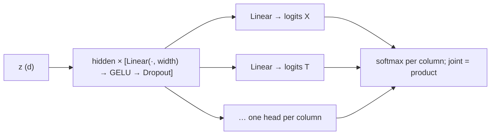
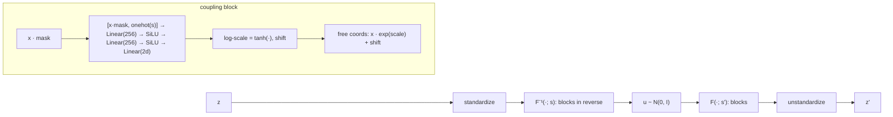
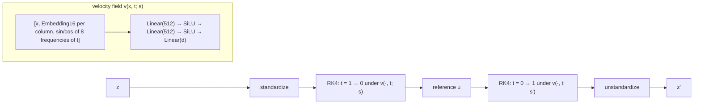
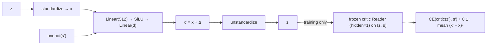
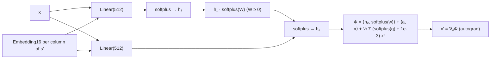
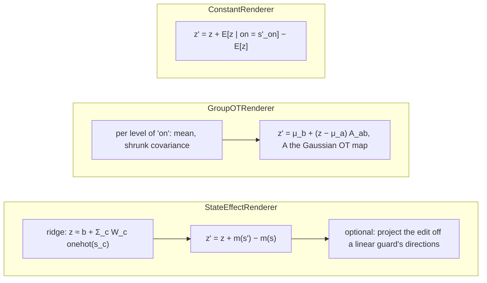

# latent_lab

**Modular latent operation (MLO)**: change what a latent `z = φ(x)` of a frozen text encoder says about a structured state, in three exchangeable steps: read the state `s = ψ(z)`, map it to a target `s' = ω_S(s)` with any operator, and render the target into the latent, `z' = ρ(z; s, s')`. latent_lab is meant to be driven from one notebook; start with [example.ipynb](example.ipynb).

| piece | symbol | in latent_lab |
|---|---|---|
| encoder | φ | `Encoder(name, dim)`: `nomic` 64–768, `qwen3` 32–1024, `embeddinggemma` 128–768; `.latents("talent")` loads cached encodings (the models themselves run in `exp/encoding/`) |
| reader | ψ | `Reader(columns, hidden=0)`: linear (`hidden=0`) or MLP probe; `cross_fit` reads each fold with readers fitted on the others, `mean_predict` averages them |
| operator | ω_S | any function `states DataFrame -> target states DataFrame`. `LinearSCM(levels, parents, noise)` gives causal ones: `.do(X=3, blocked=None)`, also path-specific; `print(scm)` shows the equations |
| renderer | ρ | subclasses of `Renderer`: `IdentityRenderer`, `ConstantRenderer`, `GroupOTRenderer`, `StateEffectRenderer` (`guard=` keeps a linear probe's reading fixed), `FlowRenderer`, `EditorRenderer` (minimal edit trained on random targets s' ~ Uniform(S)), `OTEditorRenderer` (the same with an input-convex gradient map), `OTFlowRenderer` (OT flow matching within each state, shared reference). New ones implement `_fit` and `_render` |
| MLO | ω_Z | `Pipeline(reader, operator, renderer)`; `evaluate` (an independent reader's fidelity, latent distances to target latents φ(x'), downstream) and `state_metrics` (accuracy, NLL, ECE) |

Data are loaded in the notebook with `pd.read_csv`: any table of discrete states (levels
0..k-1) indexed by unit id works.

## Architecture

Every model is fitted on observed `(z, s)` pairs only, never on edited ones. Latents are standardized per coordinate
before any network sees them (except the reader, which takes `z` as it is), and every
renderer returns `z` unchanged where `s' = s` (except `ConstantRenderer`). Defaults
below are the constructor defaults; the notebook overrides a few (noted).

### Reader ψ: `Reader`

- Conditionally independent heads: ψ(s | z) = ∏ ψ(s_c | z), so a subset of columns is
  read by dropping heads, and the joint over |S| states is one outer product.
- `hidden=0` is a linear probe (heads on z directly), which a `StateEffectRenderer`
  guard requires. The notebook uses `hidden=2` for ψ, for the judge (an independent
  reader used only for evaluation) and for π.
- GELU: a smooth ReLU. Against ReLU (`activation="relu"`; 5 seeds, d = 256) it lowers the
  joint NLL by 0.029 ± 0.014 and every per-variable NLL, at +0.010 joint accuracy.
- Loss: mean per-column cross-entropy. Selection: the epoch with the lowest joint NLL
  on a held-out `validation` share, learning rate halved after 10 stale epochs, stop
  after `patience`. Seeded in a forked RNG, so fitting leaves the global RNG alone.
- Defaults: `width=256`, `dropout=0.1`, `epochs=300`, `lr=1e-3`, `weight_decay=1e-4`,
  `batch_size=64`, `validation=0.2`, `patience=30`.

### Residual-preserving renderers

These infer a residual `u` from `z` under `s` and render the same `u` under `s'`.

#### `FlowRenderer`: conditional RealNVP

- Fitted by maximum likelihood of p(z | s); the epoch with the best likelihood on a
  `validation` share is kept.
- Masks: random halves of the coordinates, each followed by its complement, so every
  coordinate is transformed once per pair.
- tanh bounds each block's log-scale to [−1, 1], which keeps the inverse stable.
- Zero-initialized last layer: the untrained flow is the identity.
- SiLU: smooth, so the scale, shift and log-determinant are smooth in the input; not
  ablated against ReLU.
- Defaults: `blocks=8`, `hidden=256`, `epochs=100`, `lr=1e-3`, `weight_decay=1e-5`,
  `batch_size=256`, `validation=0.1`.
- Known limit: at d = 768 the likelihood barely depends on s, so the selected flow
  hardly moves z; at d = 256 it does (see the notebook, Section 2).

#### `OTFlowRenderer`: shared-reference OT flow

- Training (flow matching): draw a state by its frequency, a batch of its latents (+
  N(0, 0.01²) smoothing) and as many N(0, I) reference points; couple them by an
  entropic OT plan (Sinkhorn, ε = 0.05, cost |x − y|² / d); regress v on the straight
  path from each reference point to its partner. Latents are never coupled across
  states.
- RK4 with step doubling (64 → 256 steps) until two solutions agree to 1e-4; raises
  otherwise.
- SiLU: a smooth velocity field keeps RK4 at its fourth-order accuracy; ReLU kinks
  would need many more steps for the same tolerance.
- Embeddings instead of one-hot: a learned 16-dim vector per level.
- Zero-initialized last layer: the untrained flow is the identity.
- Defaults: `hidden=512`, `epochs=100`, `lr=3e-4`, `batch_size=64`, `smoothing_std=0.01`.
  No validation selection, learning-rate schedule or gradient clipping.

### Minimal-edit renderers

These move `z` towards a target `s'` without inferring a residual. Both are trained on
random targets `s' ~ Uniform(S)`, so no operator appears in training.

#### `EditorRenderer`

- Critic: a `Reader` fitted on the same training states, then frozen; the editor learns
  to make the critic read `s'`. With ψ(z) training states, the critic learns ψ's readings.
- Proximity penalty on the squared standardized edit keeps the edit minimal.
- Zero-initialized last layer: training starts from the identity.
- Defaults: `proximity=0.1`, `hidden=512`, `critic_hidden=1`, `epochs=200`, `lr=1e-3`,
  `batch_size=256`. Fixed epochs, no validation selection.
- Known limit: the critic is beaten off-manifold (z' read better than real latents).

#### `OTEditorRenderer`: x' = ∇ₓΦ(x; s')

- Φ is convex in x for each fixed target (non-negative weights on the hidden path,
  convex non-decreasing activations), so x' = ∇ₓΦ has OT structure: a quadratic-cost
  transport map onto its own output distribution. That says nothing about whether it
  is the right edit for a given unit.
- softplus instead of ReLU: convexity needs a convex non-decreasing activation, and a
  smooth one makes the map x ↦ ∇Φ continuous (a ReLU network's gradient jumps between
  linear regions).
- The learnable diagonal quadratic (floor 1e-3) lets the map contract; at initialization
  ∇Φ ≈ x.
- Same training and defaults as `EditorRenderer`; it learns more slowly from the
  near-identity start (the unit test uses `lr=1e-2`).

### Closed-form renderers

- `StateEffectRenderer`: additive in the levels; `ridge=1e-3`. With `guard=` (a linear
  `Reader`, e.g. of the talent proxies), the edit leaves the guard's probabilities unchanged.
- `GroupOTRenderer`: transports between groups of one column only (`on="X"`), not
  between full states; `shrink=0.1` pulls each covariance towards a scaled identity.
- `ConstantRenderer`: one direction per target level, ignores the source state;
  the only renderer that also moves units with `s' = s`.
- `IdentityRenderer`: z' = z, the lower reference.

### Operator ω_S: `LinearSCM`

One source of operators; any `states -> states` function works as well. Not learned.
Each non-root node is `clip(round(Σ w · parent + ε), 0, k − 1)` with `ε ~ N(μ, σ)`.
`do()` draws each node's noise from the truncated normal consistent with its observed
level, sets the intervened values and recomputes the descendants; `blocked` lets a node
read a parent's observed value (path-specific effects).

Notes:

- Cached latents exist for `talent` (`data/latents/talent/<encoder>_<dim>/`) and `talent_motivation` (`embeddinggemma_768` only). A width without its own cache is projected from the full-width one (Matryoshka prefix, renormalized), e.g. `Encoder("embeddinggemma", 256).latents("talent_motivation")`.
- `cached(name, lambda: ...)` (`latent_lab.cache`) stores fitted models and results in
  `models/latent_lab/` and reloads them while latent_lab's code, the cached code and the
  notebook variables it reads are unchanged. Delete the folder to start fresh.
- In pandas, use `df["T"]` for the talent column: `df.T` is the transpose.
- To run the notebook: `uv run --with ipykernel jupyter lab` (or pick `.venv` as the
  kernel in VS Code).
- The notebook's Bayes references come from the data-generating model in
  `exp/sim_talent_motivation/`.
